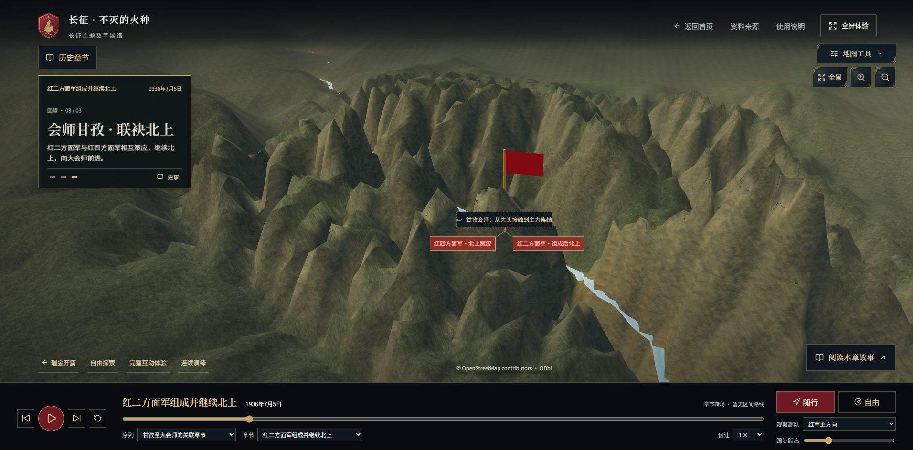

# 长征·不灭的火种

**Long March Digital Exhibition**

以三维地形为载体，结合行军演绎、历史资料阅读与区域观察，呈现长征的主要历程及不同红军部队的关联行动。项目面向历史教学、主题展陈与桌面浏览器演示。

[下载 Release](https://github.com/ArthurLloyd/long-march-digital-sandbox/releases/latest) · [版本记录](https://github.com/ArthurLloyd/long-march-digital-sandbox/releases) · [工程检查](https://github.com/ArthurLloyd/long-march-digital-sandbox/actions/workflows/ci.yml) · [问题反馈](https://github.com/ArthurLloyd/long-march-digital-sandbox/issues)



_v0.1.1 中红二方面军关联章节的实际 WebGL 画面。地形与场景采用艺术化显示。_

## 项目概览

展馆将总图浏览、章节播放和资料阅读放在同一体验流程中。观众可以随讲解了解行进方向，也可以暂停演绎，自由观察地形、切换章节并阅读相关资料。

当前版本包含 30 个演绎章节、3 条观看序列，以及 6 个历史专题、12 个基础事件、6 位人物、8 个地点和 12 项教学互动。演绎章节在基础资料上补充时间顺序、地理参考和展示说明，两者分别管理。

| 功能                 | 使用方式                                               |
| -------------------- | ------------------------------------------------------ |
| 三维地形地图         | 浏览山地、河谷与高原，旋转、缩放或定位到章节相关区域   |
| 连续演绎             | 通过统一时间轴推进字幕、战略方向箭头和章节镜头         |
| 四渡赤水与巧渡金沙江 | 结合俯视构图、分阶段路线和态势说明观看主要行动变化     |
| 多序列观看           | 切换中央红军主线、红二十五军序列、甘孜至大会师关联章节 |
| 历史资料             | 从章节或地图入口阅读人物、事件、来源及图片说明         |
| 区域体验与教学互动   | 进入已接入的区域观察内容，完成材料观察和知识互动       |
| 结尾回顾             | 连续流程结束后，通过书卷式窗口回顾长征意义             |

## 快速开始

### 使用发布包

1. 在 Releases 页面下载所需版本的 `long-march-digital-sandbox-v版本号-web.zip`。
2. 解压后阅读包内 `README.txt`。其中 `dist/` 为完整静态网页，`SHA256SUMS.txt` 在 Release 附件中提供。
3. 使用 HTTP 服务打开网页。已安装 Python 3 时，可在解压目录执行下方命令。

```shell
python -m http.server 8080 --bind 127.0.0.1 --directory dist
```

随后在浏览器访问 `http://127.0.0.1:8080/`。通过 HTTP 服务加载页面及资源，避免直接双击 `index.html`。

当前发布版本为 v0.1.1。下载发布包和对应源码均需要具备本仓库的访问权限。

### 从源码运行

开发环境使用 Node.js 24 与 npm，版本约定见 `.nvmrc` 和 `package.json`。浏览器需要支持 WebGL，桌面验收使用 Chrome 和 Edge。

```shell
git clone https://github.com/ArthurLloyd/long-march-digital-sandbox.git
cd long-march-digital-sandbox
npm ci
npm run dev
```

开发服务默认监听 `127.0.0.1`，访问地址以终端输出为准，通常为 `http://127.0.0.1:5173/`。

复现指定发布版本时，在安装依赖前检出相应标签。

```shell
git switch --detach v0.1.1
npm ci
npm run build
npm run preview
```

构建预览通常位于 `http://127.0.0.1:4173/`。日常开发使用 `main` 的最新源码，版本复现使用对应标签。

## 操作说明

从首页依次选择「开启征程 → 立即进入」，进入地图后选择「开始行军」或「自由探索山河」。

| 控件或入口                   | 作用                                   |
| ---------------------------- | -------------------------------------- |
| 连续演绎                     | 连贯观看章节、字幕与部队展示           |
| 播放、暂停与进度条           | 控制演绎进度，支持回拖与重播           |
| 序列、章节选择               | 跳转到所需部队序列和历史阶段           |
| 行军倍速                     | 按 0.5×、1×、2× 或 4× 播放             |
| 随行、自由                   | 使用默认跟随构图，或保留手动调整的镜头 |
| 观察部队、跟随距离           | 选择观察对象并调整随行距离             |
| 历史章节、史事、阅读本章故事 | 打开章节目录或相应资料                 |
| 地图工具、全景与缩放         | 调整地图视野和地形显示                 |
| 区域体验                     | 进入当前区域对应的观察空间             |

地区和章节入口依当前内容显示。浏览资料及进入独立体验时，应用会暂停相关播放并保存返回状态。

## 构建与部署

```shell
npm run build
npm run preview
```

`build` 先校验数据，再执行 TypeScript 检查和 Vite 打包，产物输出到 `dist/`。

部署时将 `dist/` 内全部文件放在静态站点根目录，保持 `assets/`、字体、视频和许可文件的相对结构。当前资源路径按站点根目录配置，部署到子路径时需先调整 Vite 基路径并验证资源访问。

素材和地形文件随仓库与构建产物管理。首次加载涉及三维资源和中文字体，加载速度取决于设备与资源传输条件。

## 开发与质量检查

| 命令                    | 用途                               |
| ----------------------- | ---------------------------------- |
| `npm run dev`           | 启动本地开发服务                   |
| `npm run lint`          | 检查代码规范                       |
| `npm run typecheck`     | 检查 TypeScript 类型               |
| `npm test`              | 执行自动化测试                     |
| `npm run test:watch`    | 以监听模式运行测试                 |
| `npm run validate:data` | 校验历史数据及展陈资源的结构与引用 |
| `npm run format:check`  | 检查代码与文档格式                 |
| `npm run build`         | 校验并生成静态发布产物             |
| `npm run preview`       | 预览已有构建                       |

内存较紧张的环境可使用 `npm test -- --maxWorkers=2` 限制测试并发。提交前运行规范、类型、测试、数据、格式和构建检查，CI 执行同一组工程检查。

v0.1.1 发布前已通过 520 项本地自动化测试，并完成相关章节的 Edge 实机复测。后续提交的检查结果以 GitHub Actions 为准。

## 技术与工程结构

项目采用 React 19、TypeScript 6、Vite 8 和 Three.js。资料与输入校验使用 Zod，测试使用 Vitest 与 Testing Library，代码质量工具为 ESLint 和 Prettier。具体依赖版本由 `package-lock.json` 锁定。

```text
src/
├── app/
│   ├── exhibition/       展馆流程、讲解、章节内容与书卷结尾
│   ├── landscape/        三维地图、地形、镜头和部队显示
│   └── experience/       独立体验调度与完成状态
├── components/           页面、导航、弹窗与通用界面
├── features/
│   ├── scene/            区域场景和艺术观察内容
│   ├── history/          历史资料与教学互动
│   └── timeline/         阶段时钟与行军播放
├── data/
│   ├── verified/         历史资料及其审核状态
│   └── fixtures/         隔离的测试样本
├── shared/               公共契约、常量与工具
├── styles/               全局样式及视觉变量
└── tests/                集成与回归测试
public/                   已登记的素材、字体与许可文件
scripts/                  校验、资源预处理与构建工具
docs/                     架构、来源、协作和验收记录
```

主地图的离线地理数据与来源记录位于 `src/app/landscape/data/`，展陈补充内容位于 `src/app/exhibition/data/`。各模块的使用约定见对应目录的 README。

## 历史资料与素材来源

基础历史资料以 `src/data/verified/dataset.json` 为入口，保留来源、内容类型、空间精度及人工审核状态。默认展馆按现有展出流程读取已校验的登记内容，展示本身不更改原始审核结论。

地图使用现代地形、水系和地名参考，包含 Mapzen / Tilezen 地形数据、Natural Earth 与 OpenStreetMap 资料。各资源的具体来源、加工方式和使用条件以对应的 provenance、manifest 及许可文件为准。

- 行军虚线与箭头按标注表达战略方向和阶段关系，不能用于测量真实历史道路、逐日位置或行军速度。
- 地形夸张、光照、旗帜和局部场景服务于展示，现代地貌参考与历史事件证据分别管理。
- 图片、影片与人物艺术素材保留各自的来源及 AI / 艺术再现说明。
- 正式史实发布依项目流程由不同成员独立复核，自动化检查用于结构、引用和工程质量校验。

详细规则、来源与素材记录见下列文件。

| 文档                                                              | 内容                             |
| ----------------------------------------------------------------- | -------------------------------- |
| [历史真实性规则](docs/HISTORY_INTEGRITY.md)                       | 史实、路线、精度与人工复核要求   |
| [历史来源目录](docs/sources/README.md)                            | 资料来源登记                     |
| [复核记录目录](docs/history-review/README.md)                     | 内容复核与交付记录               |
| [现代地理数据说明](src/app/landscape/data/README.md)              | 地形、水系及精度说明             |
| [区域影片说明](public/assets/textures/scene-cinematics/README.md) | 影片来源、选用版本与艺术再现说明 |
| [字体许可目录](public/licenses/)                                  | 字体及相关素材的许可文件         |

## 协作与反馈

功能与文档变更从最新 `main` 建立独立分支，通过 Pull Request 集成。提交前阅读项目约束、接口契约及协作说明，遵守模块所有权，并保留来源和验收证据。

- [项目约束](AGENTS.md)
- [接口契约](docs/interface-contract.md)
- [协作说明](docs/collaboration.md)
- [完整展馆接线说明](docs/architecture/full-content-exhibition.md)
- [主地图模块说明](src/app/landscape/README.md)

反馈问题时，请附上版本号、浏览器、窗口尺寸、序列与章节名称，以及可重复的操作步骤。涉及播放问题时，补充进度、倍速和镜头模式。

开发过程中生成的下载缓存、`node_modules/`、`dist/` 和构建缓存可按需重新生成。使用多个 Git 工作树时，通过 `git worktree list` 核对其用途与提交状态后再清理。验收证据、人工复核记录与未合入主线的工作应单独核对。

## 使用范围与许可

源码、第三方依赖与素材分别遵循其权利和许可条件。本仓库尚未声明项目整体的开源许可证，取得仓库访问权限不代表获得其中全部素材的再分发授权。对外展示或再使用时，请依具体资源记录确认使用条件。

当前桌面验收覆盖 Chrome 与 Edge。移动端触控、各类显卡性能、长时间运行及原生后台切换仍需结合实际演示设备验证。大型三维资源的构建仍保留包体积提示。

## 致谢

感谢 Three.js、React、Vite、Zod 及相关工具的维护者，以及地形、水系、字体和历史资料的提供者。

本文档的组织方式参考了 Three.js、React Three Fiber 与 Vite 的仓库说明，项目功能和运行步骤依据本仓库实现编写。

[Three.js](https://github.com/mrdoob/three.js) · [React Three Fiber](https://github.com/pmndrs/react-three-fiber) · [Vite](https://github.com/vitejs/vite)
