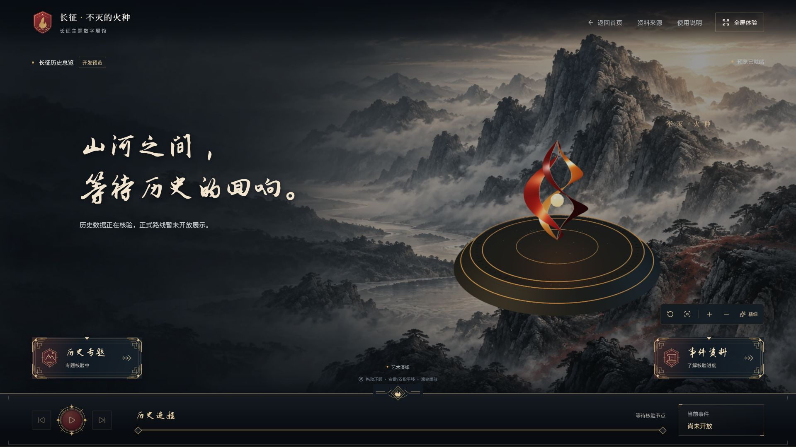
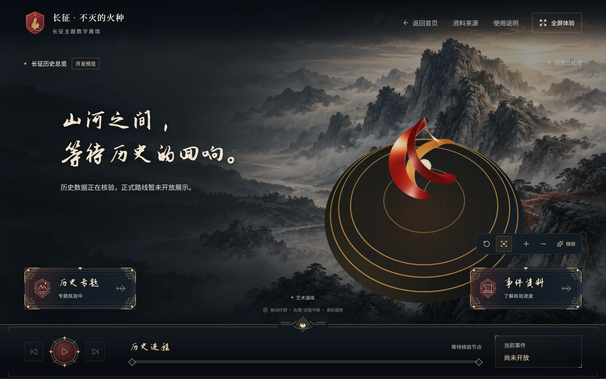

# Phase M3：PR 安全合并与组合工程验收报告

2026-11-01。范围为用户正式授权的 M3 合并及组合验收，**未开始 C3**。四项工程成果已进入 main，代码验收基线为 `b666281cdb6e80571ed2f569e02fa273e61c260c`；这是本报告生成时最新的工程 main。最终报告、截图与 README 修订通过单独的文档 PR 归档，归档不改变已验收的运行代码；归档 Merge Commit 与最终 main 状态同时在 GitHub PR 和交付消息记录，不预填尚未发生的 SHA。

## 实际合并顺序与最终状态

| 顺序 / 成果                                                                            | 审核 Head                                  | 实际 Merge Commit / 合并后 main                                                           | GitHub 最终状态                              |
| -------------------------------------------------------------------------------------- | ------------------------------------------ | ----------------------------------------------------------------------------------------- | -------------------------------------------- |
| 1 · [C0 #4](https://github.com/ArthurLloyd/long-march-digital-sandbox/pull/4)          | `6f384d2b1765a7f4b8d6a7c38743cdf263ce8799` | `a426ce3ba22fa1d2758f356dbd3a185185de23e7`                                                | MERGED，Merge Commit                         |
| 2 · [C1 #6](https://github.com/ArthurLloyd/long-march-digital-sandbox/pull/6)          | `e94d29b5eaf0a244e326ddeb19f9ff7c3f0ec2f0` | `3a6590d7111df6ee439a210d9eecec9a1b7a6889`                                                | MERGED，Merge Commit                         |
| 3 · [C2 #7](https://github.com/ArthurLloyd/long-march-digital-sandbox/pull/7)          | `098cb60467fe98f87851882f2cff981ba08d4172` | `ef96d81555cae8a4b3137c5781e1de33f4cdf0d0`                                                | MERGED，Merge Commit                         |
| 4 · [A0 替代集成 #8](https://github.com/ArthurLloyd/long-march-digital-sandbox/pull/8) | `5f60f331ed7ea1418859925705a6cb5ec19c2b69` | `b666281cdb6e80571ed2f569e02fa273e61c260c`                                                | MERGED，Merge Commit                         |
| 原 [A0 #5](https://github.com/ArthurLloyd/long-march-digital-sandbox/pull/5)           | `918b79225df6a0477081154014136de9ac20bec9` | GitHub 记录的间接整合提交为 `0b092d0da137b6add6cf2320056f4fff6499e17f`，经 #8 才进入 main | GitHub 自动标记 MERGED；没有直接执行 #5 合并 |

没有调用 #5 的合并操作。#8 的 C 集成提交以最新 main 和 A0 原 Head 为父提交，故 #8 合并后 A0 Head 成为 main 祖先，GitHub 自动更新 #5 的状态。A0 原分支和所有审查历史均保留，不能把 #5 的间接整合提交误写为 main 顶层 #8 Merge Commit。

本地 main 先从 `4b2822d` 安全 fast-forward 至原远程基线 `417d02e76f86d24d255e17b3e77d8f7c381ecea4`，再逐次同步上述 Merge Commit。每次都核对准确 SHA，没有直接推 main，没有 squash、rebase merge、强推、reset、clean 或删除成员分支。

## 审核及 base 调整

[合并前审核报告](pr-merge-review.md)已完整归档，预演分支 `codex/phase-m-review` 仍只作参考，没有整体合入 main。

- #4 合并前四个 Head、Base、原 CI 均与审查记录一致。真实差异没有修改正式数据、B 模块、来源/审核目录或 lockfile。
- #4 合并并验证后，#6 的 base 改为 main。使用 `git diff --binary` 比对 retarget 后差异与 C0 Head→C1 Head 的原审核差异，逐字一致，只含 C1。独立临时分支接入最新 main 后，整个工作树与审核 C1 Head 相同，完整检查通过。
- #6 合并并验证后，#7 同样调整为 main；与 C1 Head→C2 Head 的原审核差异逐字一致，只含 C2。独立临时分支组合树与审核 C2 Head 相同，完整检查通过。
- 原 workflow 不因改 base 自动运行。为取得当前 main 上的新 CI，#6/#7 各关闭后重新打开同一个 PR，触发 reopened；Head 和代码未变，旧讨论保留。等新 CI 全绿后才转 Ready 和合并，未用旧 PR CI 代替合并后 main 验证。

## A0 替代集成与冲突处理

#8 分支 `codex/m3-a0-integration` 从已验证的最新 main `ef96d81…` 建立，未修改 A 原分支。

1. 合入 A0 时只有已审核的 `src/tests/experience-integration.test.tsx` 文本冲突。保留当前 C1 输入、关闭后保留选择及所有断言，仅加入必要 v1 场景 mock；没有用 A 的旧整份测试覆盖新版。
2. `src/tests/App.test.tsx` 保留 A0 的 v1 场景边界 mock 和明确的测试替身标签，原其他断言保留。
3. `historical-experience-flow.test.tsx`、`history-orchestration-flow.test.tsx` 仅增加 v1 LongMarchScene mock，覆盖缺 v2 模块的 jsdom 回退路径。不提供虚假的 v2 Map/Renderer/Teaching，不删用例，不降低门禁或完成断言。
4. 在最新 main 上重新施加这些小补丁后，核对测试与 A0 场景树和已审预演一致；`src/features/scene` 与 A0 原 Head 完全一致。没有为适配测试修改 Three.js 核心、App、C0/C1/C2 生产逻辑或正式数据。
5. 本次真实组合套件重新跑出 25 文件、232 项通过，随后生产预览通过，再创建 #8 Draft。其新 CI 全绿后才转 Ready 并合并。

在源码中没有加入“测试环境假 ready”。ready 仍由 A0 的真实首帧渲染报告；mock 仅存在于生产隔离的测试文件。A0 的 GPU mock 专项和数据投影、独立原型测试也全部保留。

## 逐次检查与 GitHub CI

每一次合并后都实际执行 `npm ci`、lint、typecheck、format:check、test、validate:data、build 和 git diff --check。format 使用只读检查，不批量改写成员文件。下表均为实际合并后 main 的结果，不沿用预演数量。

| 合并后 main          | 本机完整测试        | 其余完整检查 | 新 main push CI                                                                                        |
| -------------------- | ------------------- | ------------ | ------------------------------------------------------------------------------------------------------ |
| `a426ce3…` · C0      | 14 文件、136 项通过 | 全部通过     | [41292107206 全绿](https://github.com/ArthurLloyd/long-march-digital-sandbox/actions/runs/41292107206) |
| `3a6590d…` · C1      | 18 文件、187 项通过 | 全部通过     | [41292723007 全绿](https://github.com/ArthurLloyd/long-march-digital-sandbox/actions/runs/41292723007) |
| `ef96d81…` · C2      | 22 文件、217 项通过 | 全部通过     | [41293069184 全绿](https://github.com/ArthurLloyd/long-march-digital-sandbox/actions/runs/41293069184) |
| `b666281…` · A0 组合 | 25 文件、232 项通过 | 全部通过     | [41293560574 全绿](https://github.com/ArthurLloyd/long-march-digital-sandbox/actions/runs/41293560574) |

合并前的新基线验证另行完成：#6 为 [41292595663](https://github.com/ArthurLloyd/long-march-digital-sandbox/actions/runs/41292595663)，#7 为 [41292902965](https://github.com/ArthurLloyd/long-march-digital-sandbox/actions/runs/41292902965)，#8 为 [41293364295](https://github.com/ArthurLloyd/long-march-digital-sandbox/actions/runs/41293364295)，全部成功。每个 PR 的期望 Head 都在 GitHub Merge API 传入 expected_head_sha，拒绝竞态中的新提交。

本机 Node v24.16.0 / npm 11.13.0。npm ci 继续报告既有 12 项 moderate 依赖审计问题，本轮无新增依赖/锁文件变更，没有运行 audit fix 或强制升级。Three.js 懒加载 scene chunk 超过 500 kB 的提示保留，未改构建阈值掩盖。

### 过程中停止及恢复的真实记录

- #4 合并后第一次 npm ci 因 Windows `EPERM unlink` 无法删除 `node_modules/@rolldown/binding-win32-x64-msvc/rolldown-binding.win32-x64-msvc.node` 而失败。当时立即停止，未推进 #6/#7/A0，向用户报告。
- 用户明确授权处理后，重新核对 PID 32540 确是本项目端口 5173 的 Vite 才停止它。随后 npm ci 和 C0 全套检查通过，才恢复流程。没有结束其他进程，也没有手工删除 node_modules 或其他工作文件。之后的临时预览都在重装前主动停止。
- #7 新 CI 刚完成时，自动审批仍以“CI 尚未完成”为由拒绝转 Ready/合并。没有改用其他合并机制。重新通过 gh pr checks 和 gh run view 获取新运行 completed/success 的完整证据，再使用原连接器，审批允许后才合并。

## 最终生产网页验收

Windows / Edge，代码基线 `b666281…` 的真实生产 build，使用仅 loopback 的 `127.0.0.1:4173` 预览。不是公开部署，也不是用 dev 工程数据冒充正式内容。

- 1920×1080：首页可读，点击开启征程停在确认页，主动“立即进入”才进入探索。真实 A0 火种展台可见并 ready，canvas=1；核验空态、禁用时间轴保持，没有虚构节点或路线。
- 1440×900：实际操作俯瞰控件，三维画面改变；1366×768 操作复位总览和资料抽屉。三个所测状态的 document.scrollWidth 分别为 1920/1440/1366，与 innerWidth 一致。
- 1366×768：事件资料入口显示时间、地点待核验及出处尚未发布，明确要求两名成员独立复核；关闭后焦点回资料入口。
- 返回首页 canvas=0，再次经主动确认进入后 canvas=1、aria-busy=false、ready，未累积重复画布。页面 error 日志为空。此观察不能证明所有 GPU 内存已回收或长期性能稳定。
- 临时 viewport override 已 reset，恢复默认 DOM 1912×994；验收标签已关闭，preview 进程已停止。未尝试原生窗口控制或后台隐藏暂停。

[截图与 DOM 证据清单](evidence/phase-m3/manifest.json)逐张登记代码 SHA、实际像素与证据范围。首页截图是 1920×998 的工具可见区域，而 DOM 视口为 1920×1080；不把图片高度当作视口测量。其余目标尺寸截图保留实际像素记录。

## C0/C1/C2、正式数据与生产隔离复核

- 六个体验 ID、十二个互动 ID、严格 schema、双人审核字段校验、发布依赖闭合和撤回机制均保留。B 的正式 JSON、来源/真人审核目录、history 源码与原基线比较无变化，仍为 0 事件/0 路线/0 来源，v2 扩展为空。
- C1 首次门槛、runId、完整响应/解释确认/主动完成、存储损坏与禁用恢复、重播/未完成退出、撤回与焦点/上下文均由合并后完整自动套件重新验证。
- C2 唯一阶段时钟、专题内部顺序、旧事件计时禁用、当前部队/原路线筛选和空间投影、阶段恢复及发布撤回都在同一组合套件通过。工程样本始终仅在测试/工作台使用，不进入正式网页。
- 实际生产 build 只输出主 index.html，扫描 JS/HTML 未发现 `/__dev/contracts`、fixture-event、工程专题甲、test-only-person、THE CROSSING 或 createBridgeStudy。构建模块图隔离插件及其负向测试保持启用。
- A0 相机、节点/原路线显示、ready/error 和释放代码与 A 原提交相同。独立《渡》只在开发入口，未被当成正式泸定桥体验或历史地图；本轮没有将程序艺术场景称作核验史实。

后台隐藏暂停专项：**未验证，用户选择本轮暂不验收**。此前受阻记录保留，不计通过，不作为本轮合并额外条件。历史内容真人独立复核、素材发布权利与地图规范核查也没有因工程检查通过而被认证。

## 保留分支、未完成项与 C3 阻塞

已通过远程 refs 核实 feat/3d-scene 仍指向 `918b792…`，feat/app-shell 为 `6f384d2…`，feat/c1-experience-controller 为 `e94d29b…`，feat/c2-history-orchestration 为 `098cb60…`；没有删除或强改成员分支。原 #4/#6/#7/#5 工程内容均已到达 main，A0 替代 #8 已合并。

当前没有尚未解决的合并冲突或失败检查。以下是后续范围，不是已完成的 C3：

1. A 仍只导出 LongMarchScene v1，没有 LongMarchSceneV2/ImmersiveExperienceRenderer。真实阶段图层、部队绘制、沉浸 runId 回调、正式相机书签和媒体生命周期仍待 A 交付。
2. B 仍只有基础 HistoryEventPanel；正式泸定桥事件/五段剧本、ld-01/ld-02 材料和互动 UI、反馈解释、正文/等价图文、人物地点和许可/来源包尚待交付。
3. 正式内容需要两名不同真人的独立复核，不由 Codex 代签。未经复核候选只能隔离联调，不能向正式网页发布。
4. 本轮未做新集成版 FPS/GPU 耗时、长期内存压力或媒体性能认证，不复用 A 的旧设备帧率。既有依赖审计与 scene 包体积问题保留，未擅自升级或优化。

本轮停止于 M3 稳定 main 和本报告。没有建立 C3 开发分支、修改 B 历史资料、生成长征路线或部队位置、手机精修、应用封装、付费 AI、公开部署或成员私信。
