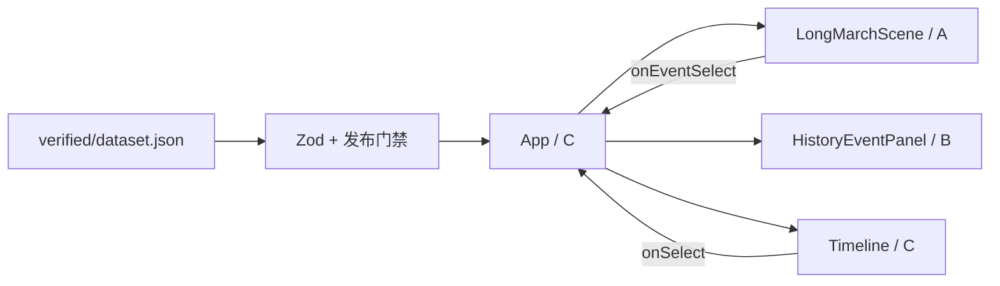

# 架构与初始化决策

## Phase C1 更新

新增独立历史体验 reducer、统一对象路由、模块适配、浏览器完成服务和 ExperienceHost；首页 landing/entering/exploring 保持独立。正式 App 仍从同一 verified/dataset.json 经 C0 门禁读取；产品关联索引仅用于防止撤回体验降级为普通阅读。

普通关资料保留选中，显式 pause 替代 toggle 暂停。历史阶段、演绎进度和完成记录分开，退出/完成不自动恢复宏观播放。等价内容和必要互动仍由 B 提供，渲染/媒体与资源释放由 A 负责，C 用 runId 和当前发布状态约束回调。

开发新增仅测试入口的 C1 工程闭环，记录使用独立键；生产模块图检查保持开启。详见 [C1 接线](c1-integration-guide.md) 和 [桌面证据边界](phase-c1-desktop-qa.md)。以下阶段说明保留其历史范围。

## Phase 3 · C0 更新

公共契约现在支持 v1 和显式 schemaVersion: 2；正式 JSON 与现有 App、A/B 组件仍保留旧基线。v2 增加专题、阶段、人物、地点、部队、剧本、互动、等价内容和素材，统一进行关联与审核验证，再以依赖图计算发布闭合视图。具体字段见 [接口契约](../interface-contract.md)，接线见 [v2 接入说明](v2-integration-guide.md)。

历史时钟、演绎时钟、用户完成记录分离；C0 仅定义契约和纯验证函数，没有实现正式状态机或存储。开发工作台由仅 serve 的 Vite 插件提供，生产入口不引用测试样本，构建插件检查实际模块图。素材发布还执行文件存在和目录边界检查。

以下初始化决策及已有运行行为继续有效。

## 范围

React 19 + TypeScript 严格模式 + Vite。Three.js 与 R3F 仅预安装，本次不实现真实场景。不加入后端、AI 服务、商业地图、桌面或 Android 封装。使用原生 CSS 与 Lucide 图标；Zod 同时定义运行时结构与 TypeScript 类型，避免两套契约漂移。

## 数据流与边界

`shared/contracts` 是唯一公共契约来源。scene/history 不依赖 app，也不互相依赖。app 通过模块 index 导入；重型 scene 使用 lazy 与 Suspense。布局、错误恢复、空态、加载态由 C 的 SceneViewport 管理；A 的 props 错误回调用于可恢复的 WebGL／资源错误。

App 管理面板切换、当前事件、场景状态、全屏。`usePlayback` 管理节点索引、播放开关、进度和关闭状态；每 4 秒切换一个核验节点，结尾停止。此阶段没有空间插值或路线动画，时间轴进度只是节点序号归一化，与地理路径无关。

## 状态选择

比较了 app 局部状态、全局状态库与事件总线。当前选择 useState + 小型 reducer：数据静态且层级浅，props 清晰，没有新增 Zustand 依赖。未来复杂镜头、章节和教学状态经 C 评估后可引入 store，保持 props 不变。事件总线会隐去数据流，本阶段不使用。

## 展示与可靠性

深色展馆式界面，左侧专题、中央沙盘、右侧资料、底部回放；窄屏纵向排列。暗红用于主选择与播放，金色用于来源提示，正文采用清晰对比。抽象几何只展示占位底座，无历史或地形含义。禁用控件使用真实 disabled；导航更新说明面板；保留键盘焦点、跳转链接与减少动态效果支持。

## 质量控制

单元测试覆盖应用启动、空态、数据门禁与播放。CI 顺序执行 npm ci、typecheck、lint、format:check、test、validate:data 和 build。生产构建也执行发布数据校验。fixtures 只供测试，不能作为应用入口。三维模块合并后由 A 补充 WebGL 和真实资源加载验证。
