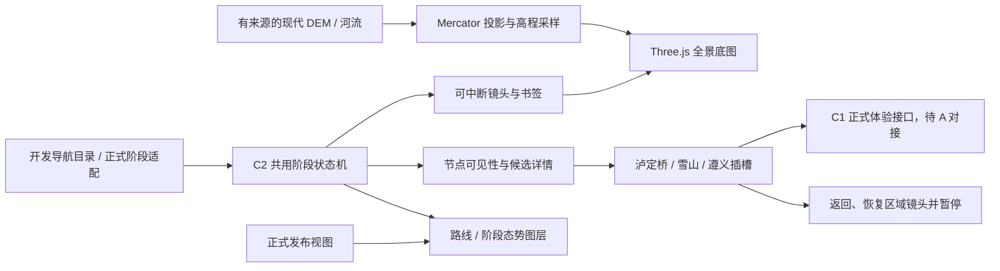

# 长征全景地图框架：设计与实施基线

## 目标与范围

本轮依据用户新的成员 C 任务书建设全景框架，不再以大渡河局部场景充当系统本体。基线为 main `91840e13e6f7691eee2b40ba2225644ba6bc8a73`；独立分支 `codex/panorama-map-framework`。不合并 #12/#15，不修改 A/B 专属文件，不启动此前未授权的其他 C3 工作。

第一版是可操作、可验收的开发原型。地图覆盖东经 96–118°、北纬 23–39°，以江西至陕甘、湘桂至川滇的中央和西南区域为首版窗口，包含红二十五军方向的东侧扩展空间；这是可配置的技术视窗，不是历史路线或政治边界。后续主力、支队与具体阶段有证据后可扩展覆盖；不能据此宣称所有部队每一段史实均已完整复原。

## 现有代码审计

| 模块                                   | 决策                       | 原因                                                              |
| -------------------------------------- | -------------------------- | ----------------------------------------------------------------- |
| C2 `useHistoricalPhase`、reducer       | 复用同一状态机内核         | 已有暂停、逐阶段、旧 tick 拒绝、专题隔离；不新增独立正式历史时钟  |
| C2 `scene-phase-view`、`force-state`   | 保留，作为正式接线输入     | 已按阶段过滤合法空间和部队；无坐标、hidden、撤回内容不能绘制      |
| C1 体验与完成存储                      | 保留，正式沉浸继续交给 C1  | 不从地图原型伪造 ready、终点、完成，也不写正式完成记录            |
| B 六专题与九阶段                       | 只读候选参考               | 所有审核字段保持原样，候选不经“模拟批准”升级；在开发页标注未复核  |
| A `createRegionalRenderer`、大渡河 DEM | 不作为全景底座             | 覆盖约 0.44×0.40°，工程路径与独立演示时钟不能扩大为全长征真实路线 |
| A 峡谷、桥、环境图、18 人编队          | 保留，未来通过公共插槽挂接 | 不能复制、重构或把艺术小样冒充正式历史模块；v2 公共出口尚待 A     |
| 现有展馆样式、字体、发布校验           | 沿用                       | 原型隔离，不改正式首页、正式历史数据与发布门禁                    |

## 架构

地图分为全景、区域、沉浸入口三个层级。现代地理网格、现代河流、事件区域标识、已审核路线、部队态势、界面标签分别管理。C 只定义可替换的渲染与镜头边界，A 后续替换地形、材质、光雾和局部表现。

阶段状态使用 C2 同一 reducer 与定时器内核。开发原型使用不带审核字段的导航模型，明确是“浏览顺序”，不把多个军团的历史压成一条伪造的全局时间线。正式接入仍由 `useHistoricalPhase(published)` 驱动，专题、phaseId、空间投影语义不变。

镜头以同一 WGS84→Web Mercator 坐标系定位。点击技术节点使用区域取景框，不向 B 的 `coordinates:null` 写入坐标。近远景采用对数距离和最短方位角过渡，约 1.6–2.4 秒，可被拖动中断；减少动态偏好下直接定位。区域取景同时检查完整地形视线、相机附近净空和可见现代河段，不用固定低空偏移穿山。进入沉浸入口保存 scene-local 书签，返回恢复镜头并暂停，不触发 C1 完成。

## 数据真实性与四渡赤水

现代地理使用 Mapzen / Tilezen Terrarium z6 的 16 张公开瓦片，385×321 网格；Natural Earth 1:10m 河流保留原顶点和范围内连续河段。下载 URL、原始 SHA-256、上游版本、输出哈希及处理方式存入 `src/app/panorama/data/provenance.json`。无运行时外部取数。地形提供 1×/6×/12×/24×，默认 12 倍艺术增强以利大陆尺度读图，清楚标注；不是 1935 地形复原、完整水文或可测量工程地形。

技术取景框覆盖瑞金、遵义、赤水流域、金沙江相关区域、泸定、夹金山相关区域、草地相关区域和陕甘会师观察范围。中心标记仅表示区域导航焦点，不是事件发生点、渡口坐标、部队位置或史实地理精度。

当前 B 路线为 0，所有历史位置仍未知。真实地图上的红军、国军、多主力与局部路线接线层可见，但没有证据时保持空。**不能把节点连线、直线或现代道路当成历史轨迹。**

四渡赤水优先做四阶段选择、过程说明、全局/区域/跟随入口和双阵营线型演示。四个渡河插槽在独立的非地理工程示意板上展示：图内使用归一化坐标，无经纬度，不与现代河流对齐，不暗示真实渡口和战术。阶段标题和时间沿用 B 候选记录；真实红军与国军拉扯全过程的地图几何仍是待 B 人工复核的阻塞项。原型必须如实给出此限制。

## 实施顺序和验收计划

1. 获取并记录现代地理来源，生成离线地形、河流与统一投影。
2. 提取 C2 共用时钟内核，保留旧接口与全部回归测试。
3. 创建 `/__dev/panorama`：总览地形、技术节点、阶段导航、候选资料、路线层空状态。
4. 实现平滑镜头、用户中断、全览/俯瞰/跟随、沉浸入口书签和返回。
5. 完成四渡赤水非地理工程板，提供四渡切换、双阵营线型、近景队伍占位与明确隔离。
6. 为投影、路线拒绝、阶段内核、节点/入口返回、生产入口隔离增加行为测试；原有测试保留。
7. 执行 npm ci、lint、typecheck、format:check、test、validate:data、build、git diff --check；浏览器验证桌面三尺寸、真实 WebGL、点击、播放和返回。按既有决定跳过原生后台隐藏专项。

界面沿用现有深墨青、米白、暖金；红/蓝分别表示路线图层角色，线型与文字同时区分。地图占主画面；左侧导航、右侧资料、底部阶段栏，常用按钮键盘可操作并有焦点状态。不给 A 的艺术素材或 B 的未知权利图片赋予新发布资格。

## 用户在预览中追加的视觉要求

1. 独立入口是框架草稿，最终必须融入现有“开启征程→立即进入”的探索页面。正式融合保留 `App` 的页面状态、现有导航／资料抽屉／`PhaseTimeline`，只替换中央场景视口和接入节点路由；不把本原型的整套按钮布局当作最终页面，也不替换正式首页。
2. 事件推进镜头由较高的区域俯视改为更贴近地势的低角度推进；默认全景保留。真实高程轮廓上提供 1×/6×/12×/24× 显示高度，1× 没有额外高度夸张，其他档位明确标注艺术增强。进行 Web Mercator 本地纬度尺度补偿；河流加宽为屏幕表达，不代表测得河宽。
3. 点击事件标志、导航或资料标题可呈现电影题字。使用项目已采用、具备 OFL 授权的志莽行书，新子集覆盖全部事件名，10,696 字节；保留来源和哈希，不冒充历史人物题词。
4. 题字出现时收起浮动标志和资料面板，地图区域展开；再次点击题字或左侧同一事件后恢复当前资料和阶段。题字期间阶段控制仍可操作；减少动态偏好下不运行题字和镜头动画。
5. 材质、精细地形、真实河流水面、水墨风格和最终展馆融合仍需后续单独验收。当前低分辨率网格在强夸张近景下可见棱面，不能将其描述成完成了电影级真实场景。

## 水体与区域细节精修（进行中）

已补八个区域的 z9 现代高程窗口，72 张原始 Terrarium 瓦片，各保存 385×321 高程。区域显示使用 769×641 网格和有界双三次采样，原始米数不改写。三平面程序岩石、植被色层、环境反射、方向阴影与空气透视均属艺术渲染；没有卫星贴图或历史植被推断。

赤水河、大渡河另有 OSM 原始中心线，49 个 way、独立 ODbL 归属与文件哈希。水面由三角网格构成，具有横向宽度、宽窄变化、独立河床、共享岸坡、深浅色、反射和动态波纹；水位平滑、河槽及河宽／水深都是艺术显示，不是测量或历史河道重建。它们不进入历史路线表。

视觉门禁仍独立于工程检查。首次独立评审指出镜头遮挡、水面不连续、地形塑料感和标注对比度；第一批修正后，标注已解决，水面可见但岸线与峡谷构图仍未达到最终标准。当前继续按具体问题修正，PR #16 保持 Draft，未开始主页面融合。不得把这些中间状态写成视觉验收通过。
