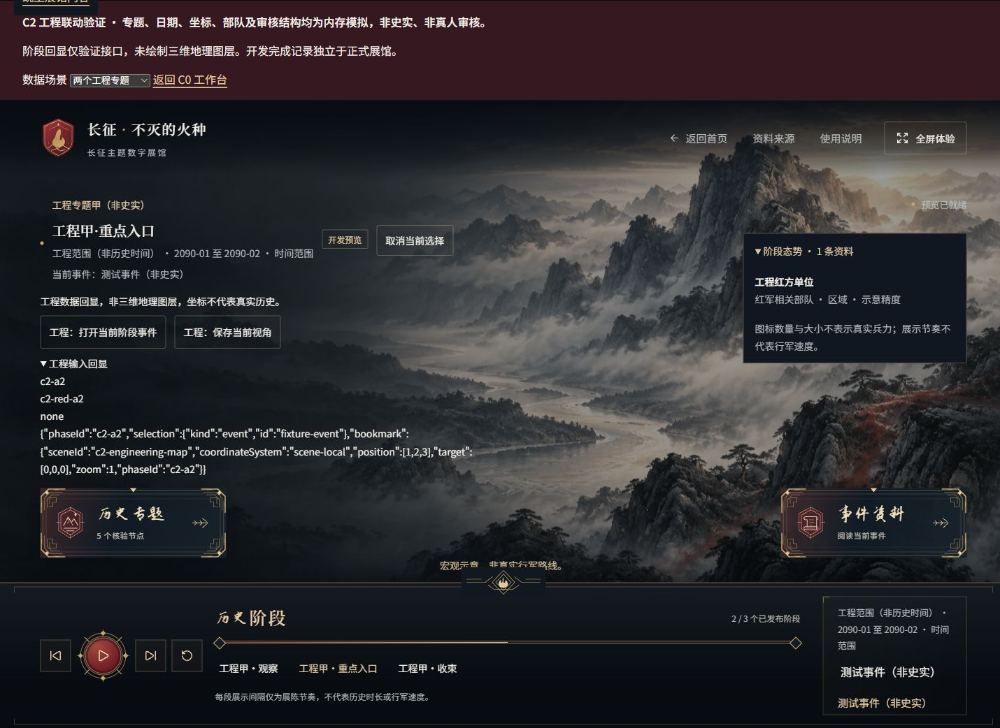
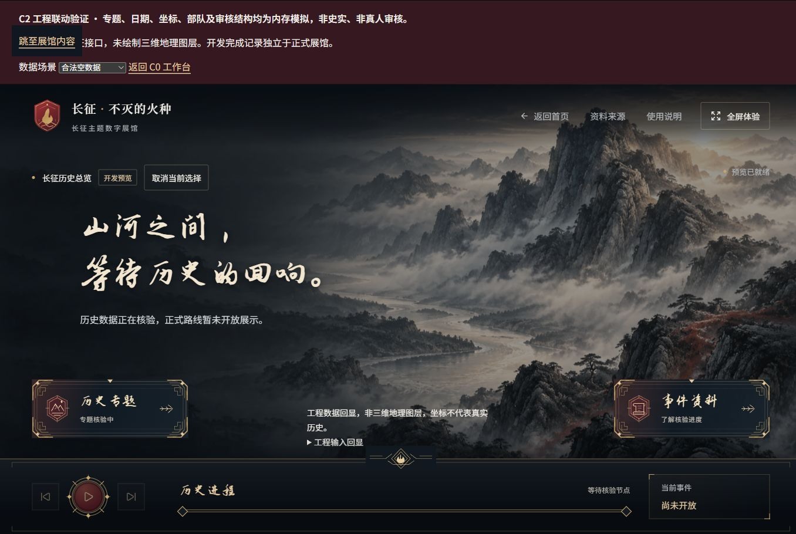

# C2 桌面验收与证据边界

2026-11-01；[Draft PR #7](https://github.com/ArthurLloyd/long-march-digital-sandbox/pull/7)。真实本机 Chrome 加载 http://127.0.0.1:5173/__dev/contracts?flow=c2，服务只监听 loopback。工程样本不是历史资料、真人审核或真实三维地理图层。

## 已实际操作的主流程

| 流程             | 观察结果                                                                                                                                                                         |
| ---------------- | -------------------------------------------------------------------------------------------------------------------------------------------------------------------------------- |
| 首页主动确认     | 开启征程停留确认页，点击“立即进入”才进入探索；刷新后同样保留。                                                                                                                   |
| 阶段播放         | 甲专题从第一段播放到第三段停止，末段播放/前进禁用；经过重点入口阶段没有弹体验，没有自动切到乙专题。                                                                              |
| 按阶段态势       | 第一段红军/国民党军工程点位，第二段只剩已给出的区域，第三段只使用原示意路线；持续示意说明可见。切到乙专题后不残留甲的单位。此处验证输入与图例，不声称已绘制三维部队。            |
| 首次与未完成退出 | 甲第二阶段从播放中主动打开事件，进入首次介绍；在第一项互动未提交时继续/完成禁用。Esc 请求退出并确认后回原第二阶段，入口焦点、选中事件和 scene-local 书签保留；重新进入仍是介绍。 |
| 等价完成         | 五段真实点击阅读，ld-01/ld-02 各提交工程响应、确认解释并继续。段落 5/5、互动 2/2、解释 2/2 后仍须主动完成；完成才打开正文。                                                      |
| 刷新记忆         | 正常刷新再主动进入、选择第二阶段、再次打开同事件，直接正文。C2 开发键独立，之前 C1 工作台的记录未让 C2 首次测试提前解锁。刷新后的宏观阶段从默认入口开始，不宣称跨会话保存阶段。  |
| 重播和键盘       | 重播体验中途退出仍保留旧完成记录。正文标题 Shift+Tab 到末尾关联史料，Tab 回关闭，Esc 返回入口；Space 重播/暂停专题，Enter 选择阶段均实际执行。                                   |
| 专题目录         | 两专题按需展开，展开多阶段形成真实抽屉滚动；选择乙专题只切探索，不进 C1。人物可独立阅读，从人物继续打开无坐标地点，显示现代对照地点与位置未知说明。                              |
| 关联与关闭       | 地点关联事件继续经过 C1，已完成事件可直接阅读；普通关闭保留当前阶段/选择，明确取消选择与专题重播单独操作。                                                                       |
| 无态势           | 乙第二段没有可发布位置，显示“该阶段暂无可发布的部队态势资料”，没有补点、补区域或连线。                                                                                           |
| 撤回             | 已有完成记录的重点正文正在显示时，撤回甲专题立即转“暂未开放”；返回后阶段清空、禁止旧事件自动回放，没有用记录重新授权。                                                           |
| 空与错误         | 合法空数据禁用播放/前后，不生成阶段、单位或正式路线；非法 phaseIds/sequence 顺序显示资料不可用，不自行排序修复。                                                                 |

## 浏览器发现与修复

1. 人物→地点连续导航保持 reading 状态，原链接卸载后焦点落到 body。新增焦点断言先复现失败，再将 selection.kind/id 纳入既有恢复 effect。efd524b 上实测焦点位于地点标题，保留当前抽屉，不反复抢占未改变对象的活跃控件。
2. 工程空输入探针覆盖原诗句，第一次移位仍与右侧卡片冲突。最终 7f3e1be 将无阶段回显放在两卡之间的留白，不显示无意义的打开/保存按钮；最终空视图截图验证文字与控件不再重叠。仅改工作台样式，没有重做首页或主题字体。
3. 展示节奏说明统一使用现有 14px 标签字号，提高桌面可读性。布局扫描中的工程横幅颜色来自已有 C1 工程区，仅用于隔离工作台；没有扩展正式配色。

## 三种桌面尺寸与截图

通过 viewport API 设置 1440×900、1920×1080、1366×768，分别实际操作了下列状态。不是手机或真机 GPU 验收。部分工具截图是可见窗口区域，部分为整页；实际图片像素尺寸均登记在 [manifest.json](evidence/c2/manifest.json)，不能把整页高度或截图裁切高度当成 viewport 测量。

| 视口      | 实际状态与证据                                                                                                                                                                                 |
| --------- | ---------------------------------------------------------------------------------------------------------------------------------------------------------------------------------------------- |
| 1440×900  | 阶段/阵营图例、进入门槛、未完成退出及书签、主动完成、刷新直达。初轮 DOM 明确输出 innerWidth 1440、innerHeight 900、document/main scrollWidth 1430、main clientWidth 1430，无该状态的水平溢出。 |
| 1920×1080 | 可滚动专题树、人物独立资料、无坐标现代对照地点，截图 07/08。                                                                                                                                   |
| 1366×768  | 专题切换、无态势、关联导航焦点修复、撤回、合法空数据和非法顺序，截图 09/10/13/14/16/17。                                                                                                       |

其他 DOM 宽度/滚动测量曾在工具会话中读取，但电脑控制停止前未导出，未据此填造数值。不能把截图看起来正常扩展成所有长正文和所有尺寸均通过的结论。

所有图片文件名前缀对应代码提交；完整 SHA 和图片尺寸见 manifest：

- 89a6460：01 阶段/阵营、02 首次介绍、03 原阶段和书签、04 等价终点门槛、05 主动完成、06 刷新正文、07 长目录滚动、08 无坐标地点、09 切专题、10 无态势、11 修复前空态问题。
- efd524b：13 连续资料焦点修复、14 已完成内容撤回、15 空态第一次移位的中间证据，后由 17 取代。
- 7f3e1be：16 非法顺序拒绝、17 最终空态布局。没有截图 12，编号保留操作记录，不补造证据。





## 真实后台暂停未计通过；工具已停止

尝试另开本机标签和切换前台后，工具读取仍报告 C2 document.visibilityState 为 visible，阶段继续到末段。没有成功建立“页面确已隐藏”的前提，因此不能将这次尝试记成真实后台暂停通过，也不能仅据此定位为应用缺陷。

随后选择目标 Chrome 原生窗口准备检查最小化时，Computer Use 返回：

```text
Computer Use has been stopped for this turn because it could not determine the current browser URL on Windows with enough confidence to enforce policy.
```

之后没有继续浏览器/桌面控制、换用另一套浏览器控制机制、改安全设置或绕过限制。最后一次 viewport override 是 1366×768，工具停止后未能执行 reset；临时标签关闭及尺寸恢复未声称已完成。此前未导出的 DOM 测量也未通过其他机制补取。

自动测试实际验证 blur/visibilitychange 后暂停、不累计墙上时间、返回仍暂停，但不冒充本项真实浏览器证据。浏览器可再次受控或由人员在普通 Chrome 中验证时，应主动播放第一阶段，切到另一窗口/标签并确认确实隐藏，等待超过两个展示间隔，返回确认仍为原阶段且暂停；再恢复浏览器原始尺寸。

## 工程结果和剩余边界

22 文件、217 项测试，lint、typecheck、format:check、validate:data、build 和 diff 检查通过。生产扫描没有开发路由、C2 控件、工程单位或模拟审核标记。正式数据仍为空，没有真人历史审核完成声明。

仍待 A/B 与后续专项：真实 v2 三维场景/部队绘制、镜头与媒体/GPU 释放、正式长正文与照片配对、真实性/授权/地图使用核查、真实后台隐藏及浏览器尺寸恢复。没有进行手机精修、应用封装、六个成品体验制作或 C3 大规模集成。
