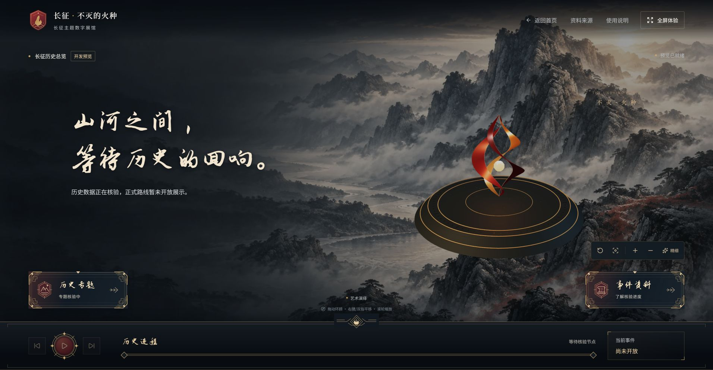
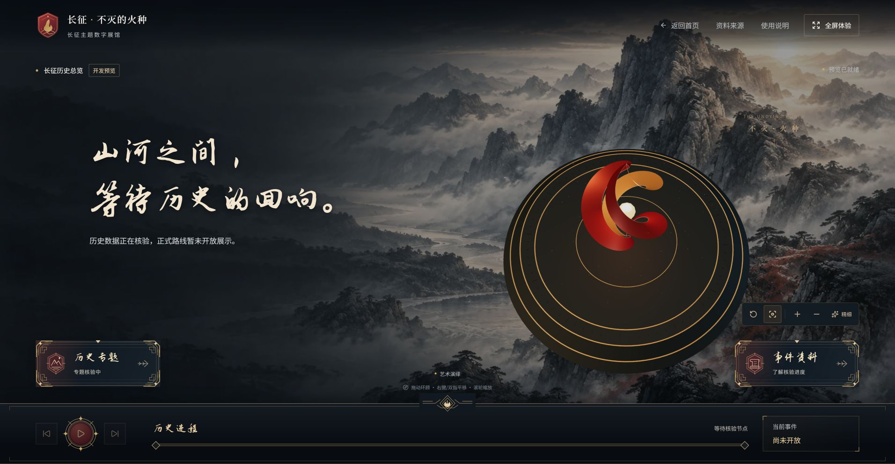

# Phase M：四个 PR 合并前审核

2026-11-01。状态：M0–M2 审查及本地合并预演完成，等待用户明确批准；尚未执行 M3 正式合并或 C3。此报告是工程审查，不是史实、真人身份、素材权利或地图合规认证。

## 结论与授权范围

C0 #4、C1 #6、C2 #7 可以在批准后按顺序进入合并流程。A0 #5 的功能可以进入基础场景集成，但不能在 C0/C1/C2 合入后直接原样合并：预演发现一处公共测试冲突，以及两项新增流程测试对旧 DOM 场景的环境假设。已在独立本地审核分支解决，完整 232 项测试通过，没有修改 A 的渲染实现或删除任何测试。

建议批准的操作范围是：先 #4 → #6 → #7，使用 Merge commit；每次更新 main 后重装、重跑全部检查，再进入下一项。最后从最新 main 建立 C 管理的 A0 集成分支，合入 A0 并带上本报告的公共测试修正，提交关联 #5 的独立集成 PR；保留 #5 原始分支及审查历史，验证和 CI 通过后再合并该替代集成。不要直接把本地预演分支整体合入 main。

用户任务书 M2 明确要求“在我明确批准合并之前，不得执行真正改变 main 的合并操作”。本轮停在该批准节点。批准不替代后续逐次检查，若 Head 改变、检查失败或出现新的冲突，先重新审查并停止后续合并。

## M0：实际仓库状态

- 工作目录：`D:\Project\miniprogram`。开始分支 `feat/c2-history-orchestration`，HEAD `098cb60467fe98f87851882f2cff981ba08d4172`，工作区干净。
- 已执行 status、branch -vv、remote、log、fetch origin，以及 gh pr list/view/diff/checks；形成报告前再次读取四个 PR，Head、Base、CI 和未合并状态均未变化。
- 远程 main：`417d02e76f86d24d255e17b3e77d8f7c381ecea4`。本地 main 仍停在 `4b2822d`，落后远程 12 个提交，本轮没有切换、改写或推送 main。批准后须先安全快进同步。
- GitHub 当前账户 ArthurLloyd 对仓库具有 ADMIN 权限，仓库允许 Merge commit、squash 和 rebase；本任务选择 Merge commit 保留祖先关系。不删除分支、不强推、不 reset/clean、不自动 stash。

| PR                                                                        | 核对的 Head | 当前 Base                     | 当前 CI                                                                                    | 兼容性                           | 风险 / 冲突                                                  | 审核结论                                      |
| ------------------------------------------------------------------------- | ----------- | ----------------------------- | ------------------------------------------------------------------------------------------ | -------------------------------- | ------------------------------------------------------------ | --------------------------------------------- |
| [C0 #4](https://github.com/ArthurLloyd/long-march-digital-sandbox/pull/4) | `6f384d2`   | main                          | [通过](https://github.com/ArthurLloyd/long-march-digital-sandbox/actions/runs/41240410872) | 保留 v1 形状与旧 props；严格 v2  | 无阻断性代码问题；不能把字段校验当真人审核                   | 工程审查通过，待授权合并                      |
| [C1 #6](https://github.com/ArthurLloyd/long-march-digital-sandbox/pull/6) | `e94d29b`   | feat/app-shell                | [通过](https://github.com/ArthurLloyd/long-march-digital-sandbox/actions/runs/41278722107) | 复用 C0；旧组件继续可用          | Draft；#4 合并后调整 base 并确认仅 C1 差异                   | 工程审查通过，待依赖合并和新基线检查          |
| [C2 #7](https://github.com/ArthurLloyd/long-march-digital-sandbox/pull/7) | `098cb60`   | feat/c1-experience-controller | [通过](https://github.com/ArthurLloyd/long-march-digital-sandbox/actions/runs/41287254609) | 单一阶段状态；C1 完成门禁保留    | Draft；#6 合并后调整 base；后台隐藏专项保持未验证            | 工程审查通过，待依赖合并和新基线检查          |
| [A0 #5](https://github.com/ArthurLloyd/long-march-digital-sandbox/pull/5) | `918b792`   | main                          | [通过](https://github.com/ArthurLloyd/long-march-digital-sandbox/actions/runs/41272939310) | v1 真实 Three.js；无 v2/沉浸出口 | 当前旧 main 下 MERGEABLE；叠加 C2 后公共测试有冲突及两项回归 | 有条件通过，必须经 C 的替代集成分支带修正验证 |

四个 PR 均 OPEN，#6/#7/#5 为 Draft。上表 CI 是各自原 Head 的结果，不是统一 main 的 CI。本地预演只有本机检查，没有声称已经取得合并后 GitHub CI。

完整 Head：

- #4：`6f384d2b1765a7f4b8d6a7c38743cdf263ce8799`。
- #6：`e94d29b5eaf0a244e326ddeb19f9ff7c3f0ec2f0`。
- #7：`098cb60467fe98f87851882f2cff981ba08d4172`。
- #5：`918b79225df6a0477081154014136de9ac20bec9`。

## 实际代码审查

### C0：兼容、发布门禁与生产隔离

核对实际差异及 `contracts/{data,dataset,experience-catalog,experiences,interactions,completion,assets,modules-v2}.ts`、`validate-dataset.ts`、`dataset-graph.ts`、`validate-v2-relations.ts` 和构建脚本。

- 旧无版本 events/routes/sources 结构仍被接受并保留返回形状；normalizeDataset 仅提供内存 v2 空扩展，不改写正式 JSON。v2 根字段及嵌套对象为严格结构，所有扩展集合和新旧模块 props 齐全。
- 六个 experienceId、十二个 interactionId 为固定映射；体验恰有对应两项必要互动，主线至少五段、终点为最后 conclusion，等价流程完整保留同一段落和互动。
- published/reviewed 仍检查不同人员的最后批准、reviewedBy 一致性、时间追加顺序和来源。reviewerId 比较忽略大小写，不能靠大小写得到第二票。机器仍无法认证真人身份、史实或权利真实性。
- 先验证引用存在，再按依赖图迭代剔除不可发布依赖。来源、素材、段落、互动撤回会使依赖内容失效；v2 允许保留撤回记录的发布意图，但不授予展示资格。track/专题循环的保守闭合隐藏策略已在文档明示。
- 素材限制为 `/assets/` 本地路径，禁止编码/父目录逃逸，published 要求 cleared；构建核对文件存在、真实路径不越界。人物艺术形象需同一人物历史照片配对，未知地点使用 null/unknown。
- workbench 插件只在 serve 注册；productionIsolationPlugin 检查真实构建模块图中的 fixtures/tests，负向构建测试实际覆盖拒绝路径。
- 正式数据、B 的来源和人工审核目录均无修改。package 只新增 dev:contracts 脚本，依赖及 lockfile 不变，没有付费服务。

### C1：唯一对象入口与完成状态

核对 routing、reducer、interaction-progress、CompletionStore、Hook、ExperienceHost 及其测试。

- 所有对象入口先走发布视图；candidate gates 只拒绝撤回内容错误降级，不展示候选史料。有效完成记录不能重新授权撤回资料。
- report 必须匹配 experienceId/scriptVersion/runId；段落仅按相邻顺序推进，互动必须属于当前段。五类响应校验材料/选项完整性，解释确认和用户继续均独立处理。
- 终点、两个互动、解释确认和主动完成共同构成保存条件。单纯计时、提前终点、未完成退出不产生记录；重播退出保留旧记录。
- 本地存储严格校验版本和 ID，损坏项忽略，拒绝写盘时保留会话进度。generation 与 storage 事件处理有测试，但 localStorage 不具备跨标签强事务保证，文档未夸大。
- 发布撤回在当前 render 即屏蔽内容，运行版本变更终止旧实例。正文关闭保留选择，显式取消选择清空；退出恢复合法阶段、焦点和书签，保持宏观暂停。
- C1 相对 C0 是独立提交后缀。merge-base(C0,C1) 等于完整 C0 Head，后续调整 base 无需重复迁移 C0；仍须在实际 retarget 后复核差异。

### C2：宏观时钟、资料与空间投影

核对阶段 selectors/reducer/Hook、App、force-state、scene-phase-view、导航组件和 C1 联动差异。

- 唯一 reducer 持有 topic/phase/playing；Topic.phaseIds 与同专题 sequence 严格一致。displayOrder 只控制目录入口，不作为跨专题时间或 E01–E06 历史顺序。
- 展示 timer 每 4 秒仅推进已给的下一个阶段，revision/modelKey 拒绝迟到 tick，末段停止；阶段模式禁用旧事件 timer。自动推进不调用体验入口。
- 当前阶段投影重新筛选 events、places、people、tracks/snapshots 及快照明确引用的原 routes；没有插值、补点、补区域或现代路网生成。切换阶段更换数组、清旧书签/选择，旧回调以最新阶段拒绝。
- 完整目录和 C1 准入继续用完整发布 catalog，空间投影不写回、不冒充新的正式数据集。无坐标地点仍可从资料目录访问。
- merge-base(C1,C2) 等于完整 C1 Head；正式数据与 A/B 实现未被 C2 改写。生产隔离保持。
- 后台隐藏暂停：**未验证，用户选择本轮暂不验收**。不计通过，不作为本次合并额外等待条件；没有重复尝试该专项。尺寸 reset 的既有成功记录保留。

### A0：真实 v1 场景、资源、原型和授权范围

逐项检查 `LongMarchScene.tsx`、`scene-renderer.ts`、`scene-data.ts`、`scene-artwork.ts`、CSS、prototype 程序与测试，并阅读 A0_ACCEPTANCE、SCENE_IMPLEMENTATION、VISUAL_REDESIGN_ACCEPTANCE、README、字体与设计研究记录。

- `scene/index.ts` 只导出 LongMarchScene，v1 props 不变；没有 LongMarchSceneV2 或 ImmersiveExperienceRenderer。空输入是程序艺术展台，不产生历史节点、路线或真实地形；正式坐标走局部平面显示投影。
- 路线使用原相邻几何；points 保持独立点；dashed 保留示意说明。progress 只控制完整源线段的展示，不创建中间历史坐标。
- 首帧渲染成功才 ready，无 WebGL2/error/context lost 有错误回调。卸载取消 RAF、断开 ResizeObserver、移除监听、销毁 controls、几何/材质、renderer 和 context；专项单元测试实际覆盖无 WebGL、失败及释放路径。浏览器画布移除不单独证明所有 GPU 内存已回收。
- 独立《渡·山河之间》从 prototype/index.html 进入，main.ts 有 DEV 保护，生产 index 没有导入它；它不写正式完成记录，不是核验过的泸定桥体验。声景默认关闭，只在用户主动操作后创建 AudioContext，退出关闭。
- 几何和纹理为 A 声明的原创程序实现，Three addons 使用既有依赖。新增五字字体子集的本地 SHA256 为 `1aac981313dbde7258f7e926f0e201f8da2f88a772199ecee6e488c5fca50356`，与交付记录一致，仓库已有 Zhi-Mang-Xing-OFL.txt 版权/许可。没有把参考网站资源或 A 的声明当独立法律认证；正式史料/地图权利核查仍未完成。
- 生产代码变化仅在 A 所有范围；两份原 C 测试是显式待 C 审核的 mock 适配。A0 没有改正式历史数据、history 模块、依赖锁文件或 CI。本轮审核没有编辑 A 的源文件。

## 预演发现及修正

本地 `codex/phase-m-review` 从 C2 Head 创建，预演合入 A0，不改变远程 PR 或 main。

1. `experience-integration.test.tsx` 产生文本冲突：C1 将旧数据 mock 改为显式输入，并保留关闭后选择；A0 在同一区域加场景 mock。解决时保留当前 C1 导入、数据输入和全部断言，只增加 A0 的 v1 LongMarchScene 边界 mock，没有采用 A0 的旧整份文件。
2. 首次统一运行结果为 25 文件、230 通过/2 失败。失败是 historical-experience-flow 和 history-orchestration-flow 中缺少 v2 Map 的回退路径真实调用了 A0，而 jsdom 不实现 WebGL，导致找不到 ready；不是判定真实 GPU 渲染失败。
3. 两份 C 流程测试各仅增加 v1 scene mock，不提供缺失的 v2 Map/Renderer/Teaching，不绕过体验准入，不改变任何原用例或断言。针对性重跑 24 项通过，再完整 232 项通过；A0 原有 15 项独立测试保留。

可复现本地检查点：`10f9af06b5af0445fb9506cc6c94e8320e57065d`，两个父提交分别为 C2 `098cb60…` 与 A0 `918b792…`。这个本地 merge 仅为审核预演，不是 GitHub PR 合并，也不是统一 main。新增测试修正属于 C，正式集成时要重新施加到最新 main，不覆盖其他成员的新改动。

## 本机和真实浏览器验证

统一预演检查点通过 lint、typecheck、format:check、validate:data、build、diff 检查；测试最终为 **25 文件、232 项通过**。正式数据仍为 0 事件/0 路线/0 来源，v2 扩展为空。无新依赖，尚未执行任务书 M3/M4 的逐次 npm ci 和合并后回归。

构建仅输出一个 index.html，扫描 JS/HTML 未发现 `/__dev/contracts`、fixture-event、工程专题甲、模拟审核、THE CROSSING 或 createBridgeStudy。保留超过 500 kB 的场景 chunk 警告，没有通过改配置掩盖体积。测试中仍有少量 jsdom canvas 环境诊断，不影响 232 项断言；没有为消除日志安装 canvas 或替换渲染实现。

2026-11-01，Windows / Edge，实际生产构建 loopback preview `127.0.0.1:4173`，代码检查点 10f9af0，默认 DOM 视口 1912×994，没有设置临时 viewport override：

- 主动“开启征程”进入确认，再主动“立即进入”，真实火种展台可见、ready，canvas=1；正式历史空态及禁用时间轴可见，没有工程节点或路线。
- 点击俯瞰，截图中的三维相机视角实际变化。
- 返回首页 canvas=0，再主动进入 canvas=1、ready，无重复画布。只验证一次退出/重进，不称长期 GPU 压力或完整性能认证。
- 艺术说明通过键盘 Enter 实际展开，读取到“不代表历史地图或真实地形”；页面错误日志为空。没有尝试真实隐藏、原生窗口控制、修改浏览器设置或复用 A 的旧帧率。
- 三张原始截图各为 1912×994，详见 [证据清单](evidence/phase-m/manifest.json)。预览标签已关闭，临时 preview 服务已停止。此次不是 M4 合并后整套三尺寸复测；正式合并后仍按任务书做完整回归。

## 批准后仍须执行的步骤和 C3 边界

1. 合并前再次 fetch 并核对四个 Head/CI。#4 Merge commit 后同步 main、npm ci 和全套检查，记录 main SHA。
2. #6 改 base 为 main，确认差异仅 C1、CI 通过，转 Ready 后合并；同样逐次检查。#7 同理，仅保留 C2 差异再合并。不要 squash 或强推破坏依赖祖先。
3. 最新 main 含 C0/C1/C2 后，从它建立 C 的 A0 集成分支，按上述修正处理公共测试；不改 A 原始分支，独立 PR 关联 #5。原 PR 的绿色 CI 不能代替新集成分支 CI。
4. 完成后生成 merge-integration-report.md，记录每次真实 merge commit、main SHA、冲突解决和完整回归；现在没有伪填任何 merge SHA。
5. 只有统一 main 稳定后才创建 feat/c3-desktop-integration。目前 A 只有 v1，B 只有 HistoryEventPanel，正式数据为空；没有 A 的 v2/沉浸渲染器、B 的完整泸定桥内容/互动组件/双人审核，不能宣称三方历史体验已经打通。C3 可先做独立接线和联调准备，不复制 A 渲染器、不补造 B 史实。

本轮未修改首页、A/B 专属源文件、正式数据或真人审核记录；未合并 PR、改 PR base/Ready 状态、发布站点、发送成员消息或开展 C3。
