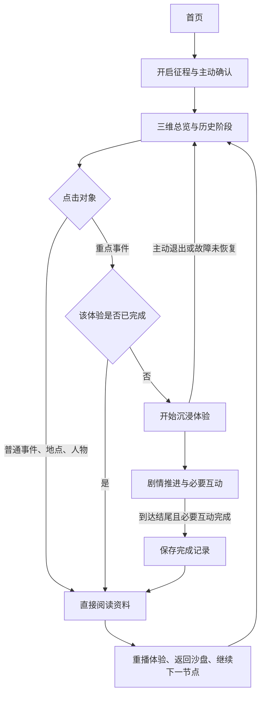

# 长征·不灭的火种：三维态势与沉浸体验总方案

版本：2026-11-01 / 需求方案 1.0。用途：A、B、C 并行开发和审阅。本文交付的是实施方案，不表示下述新功能已经完成，也不直接修改当前 v1 契约。

配套独立文档：

- [A：三维地图、部队态势与沉浸场景](2026-11-01-member-a-scene.md)
- [B：历史内容、事件剧本与人物资料](2026-11-01-member-b-history.md)
- [C：你的并行任务、接口与体验调度](2026-11-01-member-c-integration.md)
- [六个事件的统一互动与验收标准 EXP-1.0](2026-11-01-experience-standard.md)

用户已进一步确认：六个互动主题全部规划，泸定桥先打样。三份个人文档均附同版事件标准，可以单独转发；公共标准变更时由 C 同步各附录，不能三人各改一套。

## 1. 已确认需求与执行默认值

| 编号 | 需求                   | 完成时的行为                                                                                     |
| ---- | ---------------------- | ------------------------------------------------------------------------------------------------ |
| R1   | 立体地图与山川河谷     | 有来源的地形基底形成可旋转、平移、缩放的三维沙盘；可从全览进入重点区域，提供复位视角             |
| R2   | 红军／国民党军动态态势 | 在全览中依据历史阶段切换已核验部队、位置和行进示意；可暂停、前后切换，显示阶段、图例与精度       |
| R3   | 重点事件沉浸体验       | 点击指定事件进入可环顾的三维剧情演绎，在必要节点操作后继续；历史进程和结果固定                   |
| R4   | 普通资料直接阅读       | 普通事件、地点、人物点击后直接显示详情；人物动漫形象必须配对经核验、具使用条件的真实照片         |
| R5   | 首次体验、随后直达资料 | 每个重点事件分别判断完成状态；第一次先完成体验，再进入全文；完成后默认直接看文字，并保留重播入口 |
| R6   | 浏览器记忆             | 用户已确认：按每个事件、当前浏览器记忆；换设备、换站点 origin 或清除数据后不保证保留             |

本轮执行默认值：保持 Web、React + TypeScript + Vite + Three.js/R3F + 原生 CSS，不建设账号、云同步、AI 在线生成服务或商业地图 SDK。先做“飞夺泸定桥”完整样板，再分批完成其他五项；正式演绎的细节仍须通过 B 的史料、空间与素材核验。资料缺口列为阻塞，不静默删减已确认名单。

地图叙事先以中央红军主线及直接相关的国民党军阶段态势为切入范围。这是便于起步的范围建议，不代表其他红军部队走相同路线；扩展其他部队时须独立建档。

## 2. 参考图怎样使用

用户提供的参考图用于说明：有厚度的立体地形、斜俯视全览、地名标签、事件入口和远近层次。保留现有墨蓝、朱红、暗金的展馆身份，控制标签密度，地图可操作区域优先。

参考图不是可复用的地图数据或史料来源：不从截图描摹边界、提取历史路线、推断坐标，也不直接使用图中的照片。山体来自可追溯的地形数据，历史河道、桥梁、道路、行政名称另行核验。首页山河图和“长征”手迹不在本轮替换范围。

## 3. 观众完整流程

“首次强制”约束重点事件的全文入口，不把用户困在界面中：始终可退出回沙盘，退出不记为完成。开始前可显示标题、简介、来源和艺术再现说明；普通资料不加体验门槛。

无法运行 WebGL、资源失败或用户需要减少动态时，提供同一审核脚本的分步图文体验，保留必要互动和解释。等价流程真实完成后可记完成，不因一次加载错误就自动判定完成。提供字幕、键盘操作和静音路径。

体验中暂停宏观历史播放，完成／退出后恢复原节点和地图视角，播放保持暂停，由用户决定继续。关闭资料只收起资料，不再清空选中节点；这是本轮 C 将实施的行为调整，需要同步契约说明和回归测试。

六个主题各记一次完整体验；四渡赤水内部四个阶段共用一份完成记录，雪山与草地分别记录。宏观自动播放不自动拉起沉浸体验，只有用户主动打开重点事件才经过门槛。到达结尾且全部必要互动完成后，用户激活“完成体验，阅读资料”，C 再保存记录；不能用定时器自动完成。

## 4. 纯代码模拟的技术决策

| 方式                   | 优点与限制                                                                                         | 本轮选择                   |
| ---------------------- | -------------------------------------------------------------------------------------------------- | -------------------------- |
| 实时三维演绎           | 代码组织地形／道具／镜头／动画，能环顾、暂停、互动；复杂人物、史实细节和视觉质量仍需人工设计与核验 | 主方案                     |
| 预录全景视频＋热点     | 画面可预先制作，互动依赖额外热点，视角和分支受素材限制                                             | 获得合适合法素材后可作备选 |
| 从代码场景录制视频文件 | 可供展示录制；画布采集、音轨、格式支持和编码需另做验证，录制文件本身不能替代交互                   | 后续可选，不列为首轮依赖   |

技术判断：现有技术栈能够组织“可环顾、可互动的实时三维事件演绎”。这不是已经做过的性能原型，也不保证仅凭代码得到电影级人物表演或真实历史影像。A 的第一个交付必须包含可运行的小样和实际性能记录。

Three.js 提供相机绕行、缩放和平移控制；其全景示例展示了环视呈现方式。R3F 官方性能指导可用于按需渲染、资源复用和细节层次设计。[OrbitControls](https://threejs.org/docs/pages/OrbitControls.html)、[全景示例](https://threejs.org/examples/webgl_panorama_equirectangular.html)、[R3F 性能指导](https://r3f.docs.pmnd.rs/advanced/scaling-performance)。这些是能力参考，不授权复制示例中的照片。

若后续导出视频，需分别验证画布采集、音频合成、跨域资源和设备编码格式；不能承诺任意设备直接导出 MP4。[画布采集](https://developer.mozilla.org/en-US/docs/Web/API/HTMLCanvasElement/captureStream)、[编码类型检测](https://developer.mozilla.org/en-US/docs/Web/API/MediaRecorder/isTypeSupported_static)。

## 5. 两种时间与一份选择状态

| 状态                                   | 所有者                                   | 规则                                                                       |
| -------------------------------------- | ---------------------------------------- | -------------------------------------------------------------------------- |
| 历史阶段 `phaseId`、时间范围、当前事件 | C 调度，B 提供审核后的阶段顺序和映射     | 驱动全览部队态势；缺失日期保留范围／未知，不按文本日期猜排序               |
| 体验进度、剧情段落、必要互动           | C 调度，B 提供脚本，A 提供渲染与到达回调 | 秒数属于演绎节奏，不代表真实战斗时长；与宏观时间分开                       |
| 当前对象 `kind + id`                   | C                                        | 地图、专题、搜索结果（若后续建设）和时间轴共用路由；A/B 不建另一套全局选择 |
| 完成记录                               | C                                        | 每个体验独立记录；不保存在 B 的正式史实数据中                              |

现有 `playbackProgress` 是节点序号归一化，现有 4 秒轮播也不是历史时钟；不能直接据此计算部队位置、行军速度或真实日期。C 先建立阶段映射，A 消费 B 已核验的输入。

## 6. 历史空间与部队动画

- A 负责把输入画出来；B 负责部队身份、所属阵营、地点、阶段、行动先后与证据；C 负责阶段调度和发布过滤。
- 红军和国民党军均按实际部队／指挥层级登记。未知单位、兵力、方向、时间或位置不补造；图标数量不代表兵力。
- 有完整核验几何与顺序时，可沿原几何逐段显现、流动箭纹或标记推进；这是显示动画，不改变数据、不平滑路线，也不把演绎速度标成真实速度。
- 只有两个地点而没有中间路线时，只显示分阶段的地点标记，可淡出再在下一阶段淡入，不画跨空白轨迹或让图标沿推测线飞过去。
- 宏观示意必须有独立依据、按 `schematic + dashed` 展示并持续说明“宏观示意，非真实行军路线”；证据不足保持 hidden。两点属实不等于中间线属实。
- 现代 DEM 可作为地形候选基底，不能直接证明历史河道、道路或桥梁的位置和形态。A 登记采集时间、原始坐标系、投影、高程基准、处理过程与误差；B 核对历史差异。USGS 的 [SRTM 产品说明](https://www.usgs.gov/centers/eros/science/usgs-eros-archive-digital-elevation-shuttle-radar-topography-mission-srtm-1)可作为候选资料入口，使用条件和展示规范仍需针对实际素材核查。

## 7. 已确认互动清单与批次

| 优先级  | 互动主题   | 可表现方向                                     | 放行前必须补齐                                   |
| ------- | ---------- | ---------------------------------------------- | ------------------------------------------------ |
| P0 样板 | 飞夺泸定桥 | 河谷、桥体、两岸观察 ld-01，三个片段顺序 ld-02 | 时序、场景结构、参与部队、可见细节与资料使用条件 |
| P1      | 四渡赤水   | 多阶段态势切换与空间关系观察                   | 分次行动顺序、双方部队及阶段位置证据             |
| P1      | 巧渡金沙江 | 渡口环境、转场与阅读热点                       | 具体渡口、部队、地点精度和可演绎细节             |
| P2      | 遵义会议   | 会址与背景资料 zy-01，材料性质分类 zy-02       | 会址、背景与内容依据；不编会议对白或实名人物座次 |
| P2      | 翻越雪山   | 地形／见闻观察 sn-01，艺术效果辨析 sn-02       | 限定具体部队和时段，未知海拔／天气不补造         |
| P2      | 穿越草地   | 环境／生活材料 gr-01，证据选择 gr-02           | 单独限定范围，不与雪山合成同一天事件             |

以上是用户确认的产品目标，不是已经核验发布的史实清单。每项五类段落、两个具体互动、完成条件和降级要求均见统一标准。B 先提交依据与缺口，不能因名称广为人知就假定每个镜头细节都真实。首个样板的资料起点可参考[共产党员网《历史记忆中的长征》](https://xuexi.12371.cn/2016/12/16/ARTI1481870706956501.shtml)，须继续定位原始材料与独立证据，网页可读不等于图片、影片可再利用。

## 8. 契约升级：C0 先合并，A/B 并行准备

当前 v1 只有 events、routes、sources 三类数据及事件选择回调，没有人物、地点、部队阶段、沉浸脚本或完成记录接口。根 Zod 为严格结构，不能随手向 dataset.json 加数组。以下是 v2 最小语义草案，由 C0 的 PR 固化字段、schema、加载、发布过滤、模块 props 与迁移测试；本方案不冒充已经生效的契约。

| 概念                               | 最少需要表达的信息                                                                       | 内容／实现责任               |
| ---------------------------------- | ---------------------------------------------------------------------------------------- | ---------------------------- |
| Topic / HistoricalPhase            | ID、标题、事件顺序、时间范围与精度、范围说明、来源和审核                                 | B / C                        |
| HistoricalPerson / HistoricalPlace | ID、名称、正文、相关事件；人物配对素材；地点坐标与精度                                   | B                            |
| ForceTrack / ForceSnapshot         | 单位身份、阵营、阶段、位置或区域、路线引用、精度、证据、审核；允许未知和隐藏             | B / A 渲染                   |
| ExperienceManifest                 | 稳定 ID、事件关联、脚本版本、完成规则版本、段落、素材、必要互动 ID、降级脚本、来源与审核 | B / C schema                 |
| InteractionDefinition              | 提示、选项、解释、依据、是否必要；允许选错后阅读解释继续                                 | B / C 调度                   |
| AssetReference                     | 本地文件、类型、作者／机构、原链接／书目、授权、处理记录、历史照片或艺术再现分类         | B、A 各自产物；C 门禁        |
| CompletionRecord                   | experienceId、完成规则版本、完成时间、完成的必要互动 ID、完成方式                        | C 本地存储；不是史实发布记录 |

跨模块约定：A 从 `scene/index.ts` 暴露地图和拟新增的沉浸渲染器；B 从 `history/index.ts` 暴露资料和拟新增的互动内容组件；C 组合两者。A 不导入 B 内部文件，B 不控制 App 路由或直接写完成记录。

脚本为声明式数据，动作与互动类型白名单化，不把字符串作为 JavaScript 执行。新数据含历史声明时继承来源、真实双人复核和发布门禁；工程 fixtures 只用于隔离测试，不能进生产。C0 保持旧三个空数组数据集可加载，并对不合法新增引用、未发布来源／人物／部队样本实行拒绝或过滤。

## 9. 并行任务总览与交付顺序

| 阶段       | A                                        | B                                          | 你 / C                                        | 汇合条件                                           |
| ---------- | ---------------------------------------- | ------------------------------------------ | --------------------------------------------- | -------------------------------------------------- |
| 立即并行   | A0：相机／地形小样，沉浸演绎可行性小样   | B0：六主题资料核验、素材缺口、泸定桥分镜   | C0：契约提案、状态边界、样本格式和迁移门禁 PR | C0 合并后 A/B 同步；此前只做 v1 兼容工程或隔离小样 |
| 首个闭环   | A1：有来源地形基底；A3：泸定桥渲染器     | B1：泸定桥完整事件、两互动、正文及配对资料 | C1：点击路由、首次门槛、本地记忆、回到原视角  | 一个事件能完整体验、读文、刷新后直达、主动重播     |
| 态势联动   | A2：已核验部队样本的显示动画、LOD 和图例 | B2：双方部队阶段样本、地点与人物内容       | C2：历史阶段调度、筛选与资料联动              | 前后拖动／重播状态一致，无补线、无虚构兵力         |
| 扩展与收尾 | A4：复制场景机制、低画质和资源释放       | B3：扩展事件、人物照片／动漫、最终核验     | C3：设备验收、导览、来源说明、演示录制        | 六项检查、真实设备、人工内容及素材审核各自有证据   |

阶段不是日程承诺。每人尽早交可合并的小 PR，不等另两人全部做完。首轮不要求先建全国高精度场景、所有部队逐日轨迹、全部人物动画或账号系统。

## 10. 共同验收场景

1. 地图可旋转、平移、缩放和复位；全览／局部切换不会丢失当前选择。
2. 历史阶段前后切换时，双方只显示该阶段有证据的对象；空数据与未知位置不伪造标记或路径。
3. 首次点击一个已发布重点事件，地图、专题、时间轴等所有入口都进入同一个体验门槛；普通对象直接读资料。
4. 到达体验结尾并完成所有必要互动后才记完成；选错可看解释后继续。仅开始、退出、超时、报错都不算完成。
5. 完成后进入全文；刷新、重新进入、同一浏览器后续点击均直达全文；重播仍可用，退出重播不抹掉原完成记录。
6. 切换另一个未体验重点事件仍需首次体验。清除完成记录要有明确入口与确认；不因普通脚本修字自动重置完成状态。
7. 存储不可用时会话内仍可完成，明确提示无法长期保存；损坏记录可恢复，不让页面崩溃或误判全部完成。
8. 无 WebGL／资源失败／减少动态时可完成等价分步体验；地图加载失败仍能阅读普通资料。
9. 动漫人物卡与真实照片同屏、注明各自性质和来源；缺少可用真实照片时先保留文字条目，不伪造“真实图片”。
10. 打开／退出体验、返回首页、切换事件时，音频、动画、监听和 GPU 资源受控；不出现自动跳转、重复画布或后台持续播放。

## 11. GitHub 与协作基线

仓库：[ArthurLloyd/long-march-digital-sandbox](https://github.com/ArthurLloyd/long-march-digital-sandbox)。2026-11-01 已核对 [PR #3](https://github.com/ArthurLloyd/long-march-digital-sandbox/pull/3) 合入 main，基线提交 `417d02e76f86d24d255e17b3e77d8f7c381ecea4`。后续以实时 `origin/main` 为准；文档引用哈希不要求回退到旧提交。A/B 的 Issue 为 [#1](https://github.com/ArthurLloyd/long-march-digital-sandbox/issues/1)、[#2](https://github.com/ArthurLloyd/long-march-digital-sandbox/issues/2)。本次查询只看到 main 与 feat/app-shell，不推断 A/B 的本地进度。

A 在 `feat/3d-scene`，B 在 `feat/history-system`，C 在 `feat/app-shell` 工作。已有修改先提交本人工作，再 fetch／merge 最新 main。只提交自己范围，不强推、不删除他人工作，不直接改 main。所有新功能独立 PR，由 C 集成；历史内容仍须两名不同真人独立复核。

每个交付实际运行：`lint`、`typecheck`、`test`、`validate:data`、`build`、`format:check`。PR 附完成任务 ID、接口变化、真实截图／录屏、设备与性能实测、素材来源、未完成项；CI 通过不等于史实核验通过。当前已有的 50 项测试不覆盖本轮尚未建设的功能。

## 12. 本方案的完成状态

已完成：需求拆分、技术资料核对、责任与依赖定义、首次体验记忆范围确认、三份独立任务书与 Codex 提示词。

待实施：C0 契约、真实地形与部队数据、沉浸小样、人物／地点资料、首次体验状态机和设备验收。本轮没有下载地形或人物素材、生成历史图片、发布新历史数据、接入付费 API，也没有代替真人完成史实复核。
