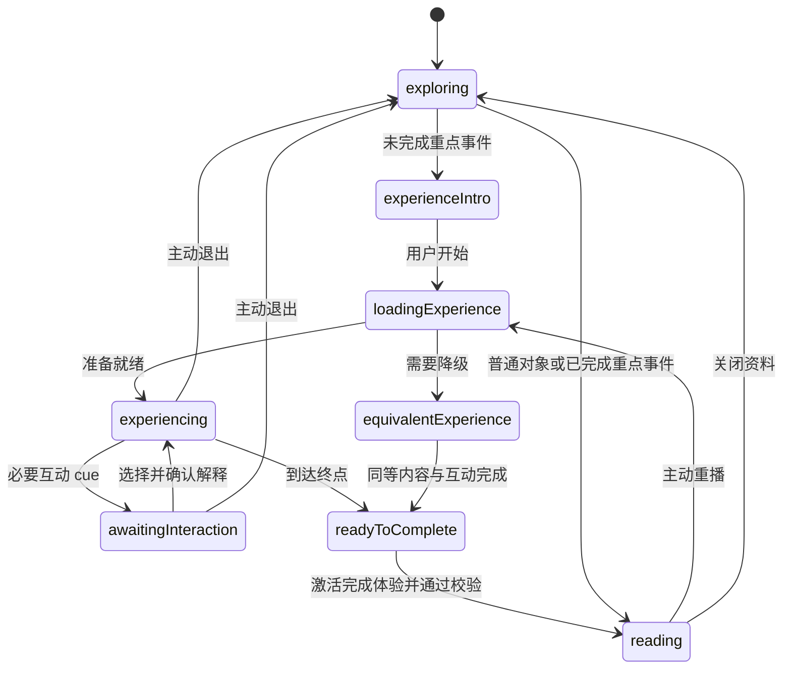

# 成员 C（你）独立任务书：契约、体验调度、本地记忆与集成

日期：2026-11-01。角色：你是成员 C，使用自己的 Codex 并行推进工程与集成，不需要等 A/B 全部完成。本任务书含整体目标、你的具体任务、验收、GitHub 流程及可复制提示词。

## 一、已经对齐的作品标准

作品包含可拖动／旋转／缩放的三维山川地图，随历史阶段切换的红军／国民党军态势，六个重点主题的沉浸互动，以及普通事件、人物、地点资料。

用户已明确选择：**完整规划遵义会议、四渡赤水、巧渡金沙江、飞夺泸定桥、翻越雪山、穿越草地六个互动主题，泸定桥先打样。** 每个主题有独立体验 ID；四渡赤水内部多个阶段属于同一体验，雪山与草地分别记录。

用户也明确选择：每个重点体验首次完成后保存在当前浏览器，再点默认直达正文；保留重播。换设备、换 origin、清除浏览器数据后可能重新体验，不建设账号或云同步。

A 负责场景与渲染；B 负责历史、剧本、资料和教学内容；你负责共享契约、历史时钟、主路由、完成判定、本地记忆、可访问界面、工程质量与合并。详见[总方案](2026-11-01-master-plan.md)与[统一事件标准](2026-11-01-experience-standard.md)。

## 二、基线、范围与保护已有成果

仓库：[ArthurLloyd/long-march-digital-sandbox](https://github.com/ArthurLloyd/long-march-digital-sandbox)。[PR #3](https://github.com/ArthurLloyd/long-march-digital-sandbox/pull/3) 已合入 main，已核对基线 `417d02e76f86d24d255e17b3e77d8f7c381ecea4`；后续以最新 origin/main 为准。C 使用 `feat/app-shell`，A 使用 `feat/3d-scene`，B 使用 `feat/history-system`。

先读根 AGENTS、README、接口、协作、历史真实性文档及本任务书。C 的修改范围为 `src/app/`、`src/components/`、`src/features/timeline/`、`src/shared/`、`src/hooks/`、`src/styles/`、工程配置、测试、CI 和共享协作文档。

保留已经复核的首页山河、手迹“长征”、红金控件和必须主动点击“立即进入”的逻辑。不要用这次功能扩展重做整个首页。

A/B 专属模块和正式史料由他们维护。若加载入口、资源目录或审核内容需要跨所有权改动，先明确接口和负责人，用协调 PR 完成；不能以 C 的集成为由修改已核验史实或代签真人审核。

## 三、你的任务总览

| 任务 | 你具体做什么                                           | 给其他人的交付                                     | 验收                                         |
| ---- | ------------------------------------------------------ | -------------------------------------------------- | -------------------------------------------- |
| C0   | 固化最小 v2 数据与模块边界，兼容 v1、补发布门禁和测试  | 契约 PR、字段说明、事件 ID、状态回调、样本编写规则 | A/B 不必猜字段，旧空数据仍可运行             |
| C1   | 全入口路由、首体验门槛、完成状态机、本地记忆、退出恢复 | 可用的演绎容器／开发接线及标准化回调               | 单个事件能首次体验、完成读文、刷新直达、重播 |
| C2   | 历史阶段时钟、专题层级、人物／地点资料入口、地图联动   | 唯一阶段状态与对象选择；A/B 公共组件组合           | 六个主题的所有入口一致，宏观时钟与剧情分离   |
| C3   | 集成节奏、设备／故障／资源验收、内容审核与演示收尾     | 小 PR 合并、QA、缺口表和展示版本                   | 各项通过证据分别记录，未核内容不会发布       |

现在即可并行做 C0；A0 工程小样和 B0 来源／脚本准备不等待 C0。C0 合并后通知 A/B 按文档同步最新 main，由用户或已授权协作渠道传达，不由 Codex 自动发送私人消息。

### 逐项工作要求

| 子任务 | 明确输入与需求                                 | 产出与通过条件                                     |
| ------ | ---------------------------------------------- | -------------------------------------------------- |
| C0.1   | 检查现有 v1、六体验与 A/B 字段提案             | 一份版本化接口说明，保留六体验 ID 和十二互动 ID    |
| C0.2   | 定义专题／阶段、实体、部队样本、脚本与资产引用 | TS/Zod、严格根结构和关联检查；空数据兼容           |
| C0.3   | 为新增类型继承发布、来源、精度与人工审核门禁   | 未发布或失效引用不会被任何场景入口显示             |
| C0.4   | 固化 A 渲染／B 内容／C 调度回调和隔离开发入口  | A/B 可按同一文档接线，生产无 fixtures              |
| C1.1   | 收口地图、专题、时间轴和关联事件入口           | 唯一路由 guard，普通对象直接读、未完成重点先体验   |
| C1.2   | 编写两个时钟分离的体验控制器                   | 互动暂停、终点、完成按钮、退出与重播状态有意义测试 |
| C1.3   | 实现稳定体验 ID 的浏览器完成存储               | 刷新可用、损坏可恢复、不可用时会话降级、多标签同步 |
| C1.4   | 组合 B 的互动和 A 的渲染，提供等价流程         | 十二互动不靠超时通过；无 WebGL／低动态可等价完成   |
| C1.5   | 保留节点、phaseId、相机书签与焦点              | 退出／完成／关闭资料各自正确恢复，重播不清旧记录   |
| C2.1   | 消费 B 核验的阶段顺序与时间范围                | 唯一宏观历史时钟；自动推进不弹体验                 |
| C2.2   | 组织专题到事件、人物、地点及相关资料           | 无坐标条目也可访问，人物图不串人，所有手动入口一致 |
| C2.3   | 接入 A 的单位、阶段、精度及示意图例            | 前后阶段、暂停／重播一致；不计算未知位置           |
| C2.4   | 按统一标准接入六个体验和各自正文               | 六 ID／十二互动映射完整，每项发布状态可追踪        |
| C3.1   | 每批 PR 检查模块边界、类型和资料证据           | 工程、内容与实际发布分批集成，不覆盖整分支         |
| C3.2   | 运行状态／门禁／存储测试和六项工程检查         | 实际结果可复现，50 项旧测试不冒充新验收            |
| C3.3   | 多尺寸、真机、故障、声音／字幕、GPU 检查       | U01–U12 的真实证据和未通过项分别记录               |
| C3.4   | 选择展示版本，核对内容、素材和地图条件         | 可运行展示、来源说明、完成范围和已知缺口           |

## 四、C0：共享契约的具体需求

### C0.1 先锁定最小语义

当前 v1 只有 events、routes、sources 和 eventId 选择，无法直接支撑本轮新需求。先在 `docs/interface-contract.md` 提交明确的 v2／兼容扩展说明，再同步 TypeScript、Zod、发布过滤与测试。

需要表达的对象：

- Topic、HistoricalPhase：专题、阶段、顺序、时间范围及精度、关联事件、来源与审核。
- HistoricalPerson、HistoricalPlace：正文与事件关联、人物真实／艺术素材配对、地点坐标及精度。
- ForceTrack／ForceSnapshot：单位、阵营、阶段样本、位置／区域、已有路线引用、证据和审核。
- ExperienceManifest：稳定 ID、适用事件、脚本版本、完成规则版本、段落顺序、必要互动、降级段落、资源与来源。
- InteractionDefinition：类型、提示、选项／材料、反馈、必要与否及证据。不执行任意脚本字符串。
- AssetReference：文件、作者／机构、来源、权利条件、加工记录、真实材料或艺术／AI 再现分类。
- CompletionRecord：本地用户体验状态，独立于历史发布数据。

ID 与字段最终在 C0 PR 固化；六个逻辑体验 ID 与互动 ID 先按统一标准保留。每个进入事件最多映射一个主体验，避免两个门槛互相跳转。

### C0.2 兼容与门禁

1. 旧 v1 的三个空数组继续合法；不要因为新功能强迫 B 立即填满资料。
2. 对 v1/v2 分别严格校验，必要时在内存归一化空的新集合，不能静默接受任意额外字段。
3. 新人物、地点、部队、体验及其来源／素材引用执行一致的关联检查和发布规则；未发布来源、失效引用、未审核历史声明不能间接漏进三维场景。
4. 样例放测试／隔离开发入口，生产不导入 fixtures。AI 可以构造测试内存，不生成生产真人批准。
5. 加载器或正式 JSON 的跨模块变更由 B 配合；C 可在共享校验与过滤中提供兼容，不能擅改 B 的审核记录。
6. 明确版本迁移、默认值、错误信息和取消发布后的界面行为。数据撤回后不因浏览器留有完成记录继续展示撤回内容。

### C0.3 模块组合边界

| 模块                 | 输入／输出语义                                                                             | 谁实现 |
| -------------------- | ------------------------------------------------------------------------------------------ | ------ |
| 三维地图             | 已发布对象、阶段样本、当前选择、阶段；输出对象点击、ready/error、相机书签                  | A      |
| 沉浸渲染器           | 已发布剧本、当前段落、播放／暂停、质量与减少动态；输出段落到达、互动 cue、终点、错误／退出 | A      |
| 事件／人物／地点资料 | 对象、相关材料与来源；输出普通导航、重播请求与关闭                                         | B      |
| 教学互动 UI          | 声明式题目、已选内容与反馈状态；输出选择、解释确认                                         | B      |
| 体验控制器           | 组合上述回调、判定通关、读写记录、打开正文与恢复地图                                       | C      |

所有类型从 `shared/contracts` 导出，模块只通过各自 index 使用。完成回调使用稳定 ID／枚举／普通数据，不传 THREE 对象、DOM 引用或任意可执行函数到内容 JSON。

提供工程开发入口让 A/B 使用隔离样本调试，但构建产物不包含未审核样本。先定义路径和构建排除方式，再启用入口，不能在 App 的正式运行分支里偷放假事件。

## 五、C1：点击路由与首次体验状态机

### C1.1 所有入口归一

地图热点、历史专题、时间轴手动选择、资料中的关联事件以及未来深链接，都调用同一对象路由。只在用户主动打开重点事件时触发首次体验；宏观自动播放更新阶段与轻摘要，不自动拉起全屏事件。

- 普通事件、人物、地点：直接打开详情。
- 重点事件，无有效完成记录：进入体验介绍／开始界面，不提供绕过全文按钮；标题、简介和来源可读。
- 重点事件，有有效完成记录：直接正文，显示“重播体验”。
- 未发布、撤回或找不到关联脚本：诚实显示不可用原因，不空转、不打开虚构体验，不因记录残留绕过发布过滤。

### C1.2 状态与完成操作



状态图是目标语义，不要求照搬为全部 reducer 枚举。无论如何实现，都须满足：

1. 只有终点已到、该脚本全部必要互动完成、用户激活“完成体验，阅读资料”后才写 completed。
2. “互动完成”默认是选择／观察要求达成，并确认看过解释；答错反馈后可继续，不强迫无限答题。
3. 仅进入页面、等待秒数、达到超时、切到后台、退出或资源错误都不算完成，不恢复旧的定时自动跳转模式。
4. 退出体验可回到地图，保留原节点、阶段与视角；未完成者下次从头开始体验。首版不承诺跨会话保存剧情断点。
5. 已完成者重播中途退出，保留已有 completed，不重新锁住正文。
6. 体验中打开人物／材料浮层暂停剧情，关闭后由明确操作继续；浮层不把主体验误判完成。
7. 打开沉浸体验暂停宏观历史播放，返回后仍暂停，用户自行继续。页面失焦／隐藏暂停剧情与音频，恢复不跳过必要节点。
8. 首次操作支持键盘与明确焦点，模态限制背景操作、支持退出与返回焦点；减少动态不意味着自动完成。

### C1.3 浏览器记忆

建议存储键：`long-march.experience-completion.v1`。按 experienceId 记录完成规则版本、完成时间、必要互动 ID 与完成方式（3d／video／equivalent）。完成时间是用户体验记录，不是历史时间。

规则：

- 同一浏览器、同一 origin 刷新／重开仍能读记录。开发端口变更或上线站点变化属于不同 origin，不能承诺迁移。[localStorage 说明](https://developer.mozilla.org/en-US/docs/Web/API/Window/localStorage)。
- 校验存储结构与 ID，不把未知字段当有效完成；损坏数据可安全恢复。
- 存储被禁用或写失败时使用会话内状态，提示本次可以完成但无法保证下次记住，不让应用崩溃。
- 不存账号、敏感个人信息或完整历史资料；本地完成记录是体验功能，不作为安全授权或史实审核。
- 普通脚本修文不强制重看；完成规则有实质变更时，由团队明确发布 completionPolicyVersion 迁移，而不是每次构建都失效。
- 提供“清除体验记录”，说明影响并确认；单纯关闭资料、返回首页或退出重播不清记录。
- 同 origin 多标签页可通过存储事件同步已完成状态，避免一个标签完成后另一个仍强制重看；不把陈旧未完成状态覆盖掉完成记录。

### C1.4 故障与等价体验

WebGL 不可用、连续资源失败、用户减少动态或确有可访问性需求时，允许使用已审核的等价分步图文体验。包含同一主线、必要材料、互动和解释，满足同一完成条件后记录 equivalent。

错误本身不能完成体验。用户可选择重试、切换等价流程或退出。若连审核后的降级内容也不存在，说明该体验暂不可用，退出不记完成，保持资料发布边界并列入阻塞项；不构造空白“点下一步就通关”的假体验。

## 六、C2：历史时钟、专题和资料入口

### C2.1 历史阶段

用 B 审核的 phaseId、时间范围、顺序及事件映射驱动地图。阶段的播放速度是展示节奏，不计算真实行军速度。现有节点 0..1 进度不可直接变成日期、部队坐标或路线补全。

前进、后退、暂停、重播都更新同一阶段；A 只消费输入。阶段没有该单位证据时允许隐藏，不从相邻阶段计算其位置。图例展示阵营、单位、时间范围和示意／精度，避免宏观动画被误认为精确态势。

### C2.2 资料选择

增加专题到事件的真实层级，人物与地点有独立详情路由；无坐标内容仍可由目录访问。B 的人物卡要求真实照片与动漫图配对，C 的素材加载与占位不能把错误照片替到另一人。

关闭资料只收起面板，保留当前选中与视角；返回首页、取消选择和关闭面板成为不同动作。更新旧契约中“关闭事件清空选择”的说明及测试，避免功能行为和文档分叉。

### C2.3 单事件集成顺序

先把泸定桥样板走通，再扩展其他五个。每次集成检查：对象点击 → 首次门槛 → 用户开始 → A ready → B 的互动 cue → 解释确认 → A 终点 → C 完成按钮 → 本地记录 → 全文 → 返回原地图。第二次点击、刷新、重播和另一个未完成事件都必须分别验证。

## 七、C3：你需要亲自推动的工作

| 工作           | 你交什么                                                 | 可并行时机                                 |
| -------------- | -------------------------------------------------------- | ------------------------------------------ |
| 统一标准       | 确认六主题、样板顺序、当前浏览器记忆、普通内容直接读     | 已确认主要范围，随文档发给 A/B             |
| C0 接口 PR     | 数据类型、schema、过滤、回调、迁移测试、开发入口         | 立即                                       |
| 体验调度 PR    | 首次门槛、存储服务、等价流程、完成按钮、退出恢复         | C0 后，不等全部模型或剧本                  |
| 视觉与素材把关 | 参考图使用边界、地形风格、照片／动漫配对、声音与字幕体验 | A/B 每批交付时                             |
| 人工核验参与   | 用本人账号对实际检查过的具体记录和证据范围作声明         | B 给出来源和完整候选后；另一名成员独立核查 |
| 测试与发布整合 | 按任务 ID 收 PR，真实设备验证，记录缺口，选展示版本      | 第一个闭环起持续分批进行                   |

历史审核必须由真实人员独立做，不能让 Codex 根据“大家看过了”批量填 approved。素材、地图和来源使用条件逐项检查；本轮方案不代表已取得任何公开展示认证。

## 八、共同验收与必须新增的测试

优先测试行为，避免只复述组件实现：

1. 六个重点体验各自独立首次状态；普通对象直接读；多个手动入口均经过同一门槛。
2. 完成所需“终点＋全部必要互动＋明确完成操作”；提前点击、重复回调、等待一分钟都不能自动通过。
3. 退出未完成、退出重播、读资料关闭、返回首页具有不同且正确的状态。
4. 刷新持久化、坏记录恢复、存储不可用降级、同 origin 多标签状态一致。
5. 无 WebGL／减少动态／失败重试与等价流程，不能靠错误直接通关。
6. 发布过滤：未发布来源、人物、部队、脚本、素材引用不能被场景或已完成记录绕过。
7. 两种时间互不推进；全局播放到重点事件不会自动弹体验；用户主动点击才进入门槛。
8. 地图相机恢复、键盘焦点、字幕、静音、真机触摸、重复开关和资源释放。

六项工程检查每个 PR 实际运行。桌面 1920×1080、1440×900、1366×768 与手机 390×844、430×932 为现有检查基准；触摸、GPU、音频、帧率和加载故障仍需真实设备与浏览器，单元测试不替代。

## 九、GitHub 同步、集成与提交

当前 C 分支已有 PR #3 提交历史，先检查 git status，保存本人工作并确认干净：

```powershell
git fetch origin
git switch feat/app-shell
git merge origin/main
npm ci
npm run dev
```

如尚未克隆，先接受私有仓库邀请并克隆仓库；如尚无 C 分支，从最新 main 新建 feat/app-shell。不要强制重建已存在的分支。使用 Node.js 24 和 npm，保留 lockfile。

新修改另开目标为 main 的小 PR，不继续把新提交算到已关闭的 PR #3。先合并 C0，让 A/B 同步，再按工程模块、内容候选、实际发布分开合并。A/B PR 到达后先读 diff、检查所有权和契约，不能一次覆盖整分支。

```powershell
npm run lint
npm run typecheck
npm run test
npm run validate:data
npm run build
npm run format:check
```

只添加本次自己的文件，使用明确 Conventional Commit，推送 feat/app-shell。PR 写任务 ID、变更行为、迁移、接口、截图／录屏、检查结果、素材／史料状态和未完成项。CI 与工程合并不替代真实双人史实复核。

## 十、给你自己的 Codex 开工提示词

```text
你是《长征·不灭的火种》的成员 C，负责共享契约、应用壳、历史时钟、体验调度、首次完成门槛、本地记忆与集成。先读本任务书及末尾完整 EXP-1.0 附录，以及 AGENTS.md、README、docs/interface-contract.md、docs/collaboration.md、docs/HISTORY_INTEGRITY.md 和有关模块说明；总方案与独立标准文件若已在仓库也一并阅读，尚未入 main 时以本任务书附录为准。

PR #3 已合入 main，已知基线 417d02e，实际以最新 origin/main 为准。检查工作区，保留本人和他人的未提交工作，在 feat/app-shell 同步后开发；新工作另开小 PR，不直接改 main。

用户已确认六个互动主题：遵义会议、四渡赤水、巧渡金沙江、飞夺泸定桥、翻越雪山、穿越草地，泸定桥先打样。每个主题独立首次完成，当前浏览器记忆；普通事件/地点/人物直接读。首次体验不因退出、错误、定时器或减少动态自动判完成；已完成后默认正文且能重播。界面保留当前首页手迹、山河和红金控件。

本轮先完成 C0：检查当前严格 v1 数据与模块 props，提出并实现最小兼容契约扩展，明确专题/阶段、人物/地点、双方部队样本、ExperienceManifest、互动、资产来源和本地 CompletionRecord 的边界。先更新接口文档，再一并更新 TS/Zod、共享校验、发布过滤和迁移测试；旧三个空数组仍可运行，任意新增字段不能静默通过。B 专属正式 JSON 和审核记录不擅改，跨模块入口调整由负责人协调。

为 A/B 固化公共 index 出口和语义：A 提供地图/沉浸渲染及 ready/error/cue/terminal/exit/相机书签；B 提供资料和互动 UI；C 组合。历史阶段、体验段落、对象选择和完成状态只各有一个权威来源。声明式脚本不执行任意 JS，生产不导入 fixtures，不加入账号/云同步/AI API/商业地图 SDK。

C0 后再分批 C1/C2：所有手动入口统一 guard；首次走体验，终点已到+必要互动完成+用户激活“完成体验，阅读资料”才保存；重播退出不清已完成，普通关闭资料保留节点和视角。宏观播放只更新阶段和轻摘要，不自动弹沉浸体验；进入体验后暂停宏观时钟，返回仍暂停。localStorage 按稳定 experienceId 保存，错误时会话降级，支持记录校验/清除确认/同 origin 标签同步，普通文字更新不强迫重看。

无 WebGL、资源故障或减少动态时使用 B 已审核的等价分步体验，同样完成必要材料与互动后才能记录完成；不提供空白通关。失焦暂停音画，支持键盘、字幕、静音、明确退出及焦点恢复。不得补造史料、坐标、双方位置或真人审核。

每批做有意义的状态、门禁、存储、错误和跨入口回归测试，运行 lint/typecheck/test/validate:data/build/format:check 并报告真实结果。先交 C0 小 PR 和 A/B 接线说明，再等各模块分批接入；性能/触摸/真实 WebGL 用实测证据，不把已有 50 项测试说成本轮全部完成。不要自动购买、上传私人资料、安装未经授权软件或发送成员消息，不替真人签署史实审核。
```

## 附录：六个互动事件统一标准（EXP-1.0）

本附录与独立统一标准同版，单独转发本任务书即可获得完整事件要求。修改标准时由 C 同步更新三份附录，A/B 不各自改写公共标准。

<!-- EXP-1.0-START -->

版本：2026-11-01 / EXP-1.0。此文件是 A、B、C 的共同验收依据。用户已明确确认按以下六个主题完整规划，泸定桥先打样。本文锁定产品结构与互动要求，不构成各项历史细节已经核验的声明。

### 1. 固定名单、逻辑 ID 与交付顺序

| 编号 | 重点主题   | experienceId                | 两个必要互动 ID | 开发批次     |
| ---- | ---------- | --------------------------- | --------------- | ------------ |
| E04  | 飞夺泸定桥 | exp-feiduo-ludingqiao       | ld-01、ld-02    | 首个完整样板 |
| E02  | 四渡赤水   | exp-sidu-chishui            | sd-01、sd-02    | 第二批       |
| E03  | 巧渡金沙江 | exp-qiaodu-jinshajiang      | js-01、js-02    | 第二批       |
| E01  | 遵义会议   | exp-zunyi-conference        | zy-01、zy-02    | 第三批       |
| E05  | 翻越雪山   | exp-crossing-snow-mountains | sn-01、sn-02    | 第三批       |
| E06  | 穿越草地   | exp-crossing-grasslands     | gr-01、gr-02    | 第三批       |

E01–E06 是文档编号，不是历史排序；最终地图阶段顺序由 B 按审核资料给出。以上 ID 为 C0 应保留的逻辑 ID，尚未写入正式 dataset。

四渡赤水内部四次行动共用一个完整体验记录，不变成四次独立强制体验。雪山和草地是两个体验，各自明确具体部队、路线／区域和时段；不把广泛过程压成一个虚构的精确日期。一个体验可以关联多个经核验事件条目，哪些入口受同一门槛约束由 B/C 明确映射，每个入口最多对应一个主体验。

本版六个主题全部建设互动体验。地点、人物和六主题以外的事件默认直接阅读；新增重点体验需三方同步标准和映射。

### 2. 六个体验共同的硬标准

#### 2.1 内容与场景

每个体验至少有：背景／地点引入、环境与证据观察、历史进程、结果与意义、明确结尾五类内容；可按审核脚本细分镜头。每个体验有两个必要互动，必要性与 ID 写入声明式脚本。

主方案是代码驱动的实时三维场景、预设镜头与可环顾视角，支持暂停、字幕、静音、退出。剧本不是实时生成的历史；真实人物不编对白、命令、表演性动作或未经证据支撑的个人经历。

场景为艺术演绎，局部坐标、天气效果、声响、剪影和镜头节奏不成为历史证据。剧本需逐项区分已核事实、编辑解释、艺术表现、未知细节；未知不靠画面填成“复原”。

画面目标沿用墨蓝山河、朱红／暗金界面与有层次的立体空间。不能把只有静态背景加按钮的小样直接当作最终三维体验验收；A0 提供实际可操作小样，C 先验画面和性能，再复制机制。

#### 2.2 必要互动的统一完成规则

每个互动都有提示、操作区、当前状态、反馈／解释、证据入口及明确“继续”。观察热点需真的打开要求的材料；选择／排序题需提交尝试并确认解释。答错有反馈，允许重新操作或阅读正确解释后继续，不要求不断猜对才能退出。

观众的选择只影响观察顺序、资料展开和教学反馈。不能改变真实行动顺序、历史人物决定、战役结果或真实人员命运；不存在以不同选项生成不同真实结局。

每个体验的完成条件严格为：

1. 主线到达终点；
2. 该体验两个必要互动均完成并确认解释；
3. 观众激活“完成体验，阅读资料”；
4. C 验证匹配的 experienceId 和完成规则版本，再写当前浏览器记录并打开正文。

仅点击开始、观看一段时间、进入后台、错误、超时或退出，不算完成。宏观自动播放只变阶段和轻摘要，不自动拉起体验；首次门槛发生在用户主动打开重点事件时。

#### 2.3 退出、重播与可访问性

- 第一次未完成可以退出回沙盘，保留地图上下文；下一次仍从首次体验入口开始，首版不做跨会话剧情断点。
- 完成后再次点击直接正文；“重播体验”始终可选，重播退出不抹掉原完成记录。
- 打开体验暂停宏观历史时钟；退出／完成后宏观播放仍暂停，用户自行继续。临时打开人物／材料浮层只暂停当前剧情，不重置。
- 无 WebGL、资源故障、减少动态或需要无三维操作的用户，使用同一脚本的等价图文分步体验，保留两个必要互动与完成按钮。
- 热点均有键盘和文字列表替代；环顾不是唯一取得必要信息的方法。字幕不依赖声音，静音不影响完成。
- 没有已审核降级脚本时明确暂不可用，不能用空白页面、故障或“下一步”次数冒充完成。

### 3. E04 飞夺泸定桥：首个样板的逐段标准

experienceId：`exp-feiduo-ludingqiao`。A/B/C 先共同完成此项，交付机制通过后再并行扩展其他五项。

| 段落       | 画面与观众体验                                                         | B 必须提供                                           | A/C 行为与通过条件                                     |
| ---------- | ---------------------------------------------------------------------- | ---------------------------------------------------- | ------------------------------------------------------ |
| ld-s1 背景 | 从区域地图过渡到艺术化河谷／桥梁环境，出现事件标题、时间范围和简短背景 | 地点、时间、相关行动的依据；现代照片与历史依据的区分 | 显示准备状态，用户开始后推进；不得用现代模型当原状证明 |
| ld-s2 观察 | 镜头给出桥体和两岸的空间关系，可环顾与点观察热点                       | 桥体／两岸可展示细节、材料与局限                     | 到达互动 ld-01 后暂停                                  |
| ld-s3 进程 | 用审核后的阶段、环境和克制运动表现交代事件进程                         | 各段真实先后、哪些可演绎、哪些不能具体表现           | 不模拟改变胜负的玩家战术；不编实名人物言行             |
| ld-s4 顺序 | 在场景旁显示三个已审事件片段，让观众整理顺序                           | 三张片段卡的准确表述、顺序依据和解释                 | 到达 ld-02 暂停；提交与解释确认后继续                  |
| ld-s5 收束 | 简要结果、历史联系，回看关键地点及史料入口                             | 有据的结果／影响概述与来源                           | 到终点后显示完成按钮，两个互动齐全才保存并开全文       |

**ld-01：观察桥体与两岸。** 提供 `ld-hotspot-bridge`、`ld-hotspot-banks` 两个热点。观众分别打开两者的说明／材料，看到“已查看”状态后确认继续；可以由文字列表打开。观察不要求像游戏一样执行夺桥动作，也不把镜头看到的艺术场景当作证据。

**ld-02：整理三个片段顺序。** B 交付三张具有可核验顺序的片段卡，观众通过点击顺序或可访问按钮排序，提交后显示结果、依据与正确顺序，确认解释后继续。错误顺序只作教学反馈，不在场景中重演为“另一段真实历史”。

最小场景元素：有依据的区域关系、艺术化河谷与桥体、观察热点、时序切换、资料覆盖层。不要求首轮制作可自由战斗的角色、精确弹道或每名参与者的写实动画。

首个资料检索入口：[共产党员网《历史记忆中的长征（七）》](https://xuexi.12371.cn/2016/12/16/ARTI1481870706956501.shtml)。具体镜头、用语、照片与引用仍须独立核验和确认使用条件。

### 4. E02 四渡赤水：分阶段态势与顺序理解

experienceId：`exp-sidu-chishui`。

| 段落           | 画面与操作                               | 内容标准                                                 | 通过条件                                 |
| -------------- | ---------------------------------------- | -------------------------------------------------------- | ---------------------------------------- |
| sd-s1 背景     | 区域地形、河流和时间范围引入             | B 界定具体部队、阶段与资料范围                           | 不用一根总箭头概括全部部队               |
| sd-s2 四段观察 | 依次查看四次行动的审核阶段卡与地点       | 各阶段时序、位置、双方单位及已知／未知范围               | sd-01 完成后继续                         |
| sd-s3 态势变化 | 根据已发布样本切换双方态势，可暂停与回看 | 有几何显示原几何，只有位置就显示位置                     | 缺证不补线；不声称动画反映精确兵力或速度 |
| sd-s4 证据判断 | 展示一个经审阶段对照与两条解释           | 一条有材料支持的解释及另一条不被材料支持的解释；理由明确 | sd-02 提交、查看解释后继续               |
| sd-s5 收束     | 时间／空间关系回顾与正文入口             | 有据的过程联系与意义                                     | 两个互动完成并主动结束                   |

**sd-01：按顺序查看四次行动。** 四张卡点击后显示对应阶段地图、时间范围、来源及局限；按 B 给出的正确顺序完成四张卡的检查。操作错序时提示并引导回正确顺序，不改变真实路线。完成列表记录四张均已查看。

**sd-02：选择有据解释。** 从 B 的两条表述中选择资料能够支持的一条；提交后给出引用定位和另一条为何不能据此推出，确认解释才继续。不得把题目变成玩家选择另一路线去“改变战局”。

最小场景元素：能看清关系的区域地形、四个阶段、双方有依据的标记、图例与阶段切换。没有完整几何时，仍可通过地点及阶段对照完成体验，但必须诚实显示精度。

### 5. E03 巧渡金沙江：环境观察与材料—结论对应

experienceId：`exp-qiaodu-jinshajiang`。

| 段落           | 画面与操作                         | 内容标准                                   | 通过条件                 |
| -------------- | ---------------------------------- | ------------------------------------------ | ------------------------ |
| js-s1 背景     | 从区域地图到经审具体渡口／区域     | B 给出具体时间范围、部队、地点精度         | 不使用任意现代渡口代替   |
| js-s2 环境观察 | 环顾河流与渡河条件，打开两类材料   | 历史可确认的环境／通行条件与资料范围       | js-01 两项材料查看完毕   |
| js-s3 主线     | 按核验的进程演绎渡河相关阶段       | 船只、设施、动作和数量缺依据就抽象化并说明 | 不让玩家选择不同历史结果 |
| js-s4 材料对应 | 两份材料与两条可支持的结论进行配对 | 每个对应关系与局限由 B 写清                | js-02 提交、读解释后继续 |
| js-s5 收束     | 总结与史料入口                     | 已审正文中的同一事实                       | 主动结束后进入全文       |

**js-01：观察两类通行材料。** 热点为 `js-hotspot-environment` 和 `js-hotspot-passage`，分别打开环境与通行条件的资料说明；两者均已读后确认继续。三维水流速度、船只数量或景观表现不能自动变成题目的事实依据。

**js-02：材料与结论配对。** B 提供两份材料、两条结论和明确对应关系；观众配对并提交，显示支持理由和不能超出的推断范围。确认解释后完成，答错不另造一条渡河方案。

最小场景元素：有依据的渡口／区域关系、艺术化河流与岸边、材料热点及阶段切换；不要求第一版拥有流体仿真或可驾驶船只。

### 6. E01 遵义会议：会址观察与资料性质识别

experienceId：`exp-zunyi-conference`。

| 段落             | 画面与操作                                 | 内容标准                         | 通过条件                           |
| ---------------- | ------------------------------------------ | -------------------------------- | ---------------------------------- |
| zy-s1 背景       | 地点与历史背景引入                         | B 给出时间范围、背景和会址依据   | 不编会场实况或未经证实的参会场景   |
| zy-s2 会址与材料 | 会址／室内艺术化场景环顾，两个资料热点     | 建筑依据、背景材料的来源与局限   | zy-01 两个热点查看完毕             |
| zy-s3 内容讲述   | 旁白与资料画面说明核验内容和影响           | 编辑概述与真实引文分明           | 不让演员／动漫人物代说虚构历史台词 |
| zy-s4 性质识别   | 三个条目分类为原始材料、编辑概述、艺术表现 | B 提供三项可明确分类的内容与说明 | zy-02 提交、读解释后继续           |
| zy-s5 收束       | 事件联系、人物与正文入口                   | 与已审正文一致                   | 主动结束并进入资料                 |

**zy-01：查看背景与会址资料。** 两个热点为 `zy-hotspot-context` 与 `zy-hotspot-site`，分别查看背景、会址依据；无需旋转到特定角度才能找到资料。没有完整室内证据时使用明确的艺术化空间，不锁定实名人物的座次、姿态或动作。

**zy-02：识别材料性质。** 将一份可定位历史材料、一段明确的编辑概述、一幅明确的艺术化场景分别归类，提交后显示分类理由和来源。玩家不投票改变会议决定、不替真实人物发言。

最小场景元素：会址空间关系或有依据的建筑表现、材料热点、旁白字幕与分层阅读；不以虚构会议对话营造戏剧性。

### 7. E05 翻越雪山：地形困难与艺术表现辨析

experienceId：`exp-crossing-snow-mountains`。

| 段落           | 画面与操作                                 | 内容标准                           | 通过条件                           |
| -------------- | ------------------------------------------ | ---------------------------------- | ---------------------------------- |
| sn-s1 范围     | 说明本体验涉及的具体部队、地点／区域和时段 | B 明确范围，不能混写所有红军经历   | 未知坐标、海拔和日期保持未知／范围 |
| sn-s2 观察     | 地形与行进材料两个观察点                   | 地形依据及可引用的见闻材料         | sn-01 两个材料点查看完毕           |
| sn-s3 行进体验 | 有节奏的观察视角推进、环境音和字幕         | 进程来自脚本；雪雾、声音属于表现层 | 不虚构实名人物受难、言行或精确天气 |
| sn-s4 表现辨析 | 判断程序雪雾等是否能单独证明当时具体天气   | 正确区分场景效果与史料证据         | sn-02 提交、确认解释               |
| sn-s5 收束     | 连接已核验的经历、意义和全文               | 不新增情绪化“原文”引语             | 主动结束并进入资料                 |

**sn-01：查看地形与行进见闻。** 热点为 `sn-hotspot-terrain` 与 `sn-hotspot-account`，分别打开地形说明和历史材料。所有精确数值必须有据；当代照片拍摄条件不被当作历史天气。

**sn-02：辨别演绎效果。** 题目聚焦“程序生成的雪雾和背景音，能否单独证明当时确切天气／声响”。提交后解释场景效果与历史证据的区别，并链接本事件实际资料；确认解释后继续。

最小场景元素：来源明确的山体关系或清楚标注的局部艺术化环境、路径观察镜头、材料热点和字幕。不给观众设置会改写真实结局的体力、饥饿或死亡分支。

### 8. E06 穿越草地：环境与补给资料观察

experienceId：`exp-crossing-grasslands`。

| 段落           | 画面与操作                               | 内容标准                                     | 通过条件                       |
| -------------- | ---------------------------------------- | -------------------------------------------- | ------------------------------ |
| gr-s1 范围     | 具体部队、区域、时段与背景               | B 与雪山体验分别建档，避免范围混用           | 不是同一背景换贴图就算另一事件 |
| gr-s2 材料观察 | 环境与生活／补给材料两个观察点           | 对应原始材料或明确编辑说明                   | gr-01 两类材料查看完毕         |
| gr-s3 主线     | 克制的环境与行进视角，呈现核验内容       | 人物与困难叙述有来源；不靠随机数生成真实故事 | 不虚构真实人物生死、台词或行为 |
| gr-s4 证据选择 | 对一个有据的困难解释，选择能支持它的材料 | 两个选项区分史料依据与艺术场景表现           | gr-02 提交、确认解释           |
| gr-s5 收束     | 资料、经历联系与全文                     | 与已审正文一致                               | 主动结束后打开正文             |

**gr-01：查看环境与生活材料。** 热点为 `gr-hotspot-environment` 与 `gr-hotspot-supply`。第二项的具体资料主题由 B 依据可取得材料定为生活／补给说明，不能编造个人日记或粮食配给数字。

**gr-02：选择支持材料。** B 提供一条经核验的解释、一个对应史料选项和一个明确的艺术场景选项；观众提交后理解哪种材料能支持历史结论、哪种只能辅助感受，确认解释后继续。

最小场景元素：限定区域的环境表现、观察镜头、两个材料热点和对应反馈；不制作可改变历史主线的生存结局游戏。

### 9. 普通事件、地点、人物和完成后的正文

- 六主题之外的事件默认直接正文，除非后续明确增加重点体验并更新标准。
- 六主题关联子事件是否共用门槛由唯一映射规定；不能不同入口各弹一份重复体验。
- 地点正文包含历史名称、现代对照、事件关联、精度和材料性质；缺坐标仍可从目录访问。
- 人物动漫图必须与同一人的真实照片配对、分别说明与署源。无可用真实照片先文字展示并列缺口；不拿绘画／生成图伪装真实照片。
- 重点主题的正文必须独立完整：背景、经过、结果／影响、关联人物地点、来源及局限；体验完成后可直接读文，不依赖视频才能理解。
- 真实历史照片与当代纪念照片不混标；动漫／AI 图注明制作属性。使用条件不明的素材不发布。

### 10. 每个体验统一交付包

| 责任人 | 必交文件／内容                                                                                     |
| ------ | -------------------------------------------------------------------------------------------------- |
| B      | 事实包、可定位来源、段落剧本、两个互动定义及解释、降级脚本、完整正文、人物地点关联、素材与审核记录 |
| A      | 对应场景、镜头与可环顾操作、热点、段落／互动 cue／终点回调、质量档位、资源释放、真实演示证据       |
| C      | 稳定映射、统一入口门槛、完成状态机与本地记录、明确完成按钮、资料路由、退出恢复、错误与可访问性测试 |

三方交接字段至少包含 experienceId、脚本版本、完成规则版本、关联事件、段落 ID、必要互动 ID、终点 ID、资源／来源 ID、降级内容和审核状态。B 在 C0 之前交文字提案，C0 合并后按真实 schema 录入，不能把本标准表格直接当生产数据。

### 11. 统一验收编号

| 编号 | 操作与预期                                               | 主责  |
| ---- | -------------------------------------------------------- | ----- |
| U01  | 六主题清单、ID、两项必要互动与正文一一对应               | B/C   |
| U02  | 首次主动点任一重点入口先体验；普通对象直接读             | C     |
| U03  | 宏观自动播放不自动弹体验；体验中两个时钟互不推进         | C/A   |
| U04  | 每项观察／选择／排序有真实操作、状态、反馈和依据         | B/A/C |
| U05  | 终点、两互动、明确完成按钮缺一不可，定时器不代替         | C     |
| U06  | 完成后同浏览器刷新直达正文，另一个未完成主题仍首次       | C     |
| U07  | 未完成退出不通关，重播退出不清已有完成，返回原节点／视角 | C/A   |
| U08  | 等价图文、字幕、静音、键盘与减少动态路径可完成同一内容   | B/C/A |
| U09  | 阶段部队位置／路线有据，缺证不补线，回退不残留未来态势   | B/A/C |
| U10  | 真实照片／艺术图身份明确且配对正确，正文与剧本一致       | B/C   |
| U11  | 未发布数据与素材引用被门禁过滤，不伪造人工审核           | B/C   |
| U12  | 桌面／手机实际操作、加载失败、重复开关与资源／性能有证据 | A/C   |

首个泸定桥样板至少通过 U01–U12 中适用项后才复制到其他事件。记录未适用项及理由；静态截图不能证明交互、性能或连续动画，已有单元测试不能证明新场景已经通过。

<!-- EXP-1.0-END -->
